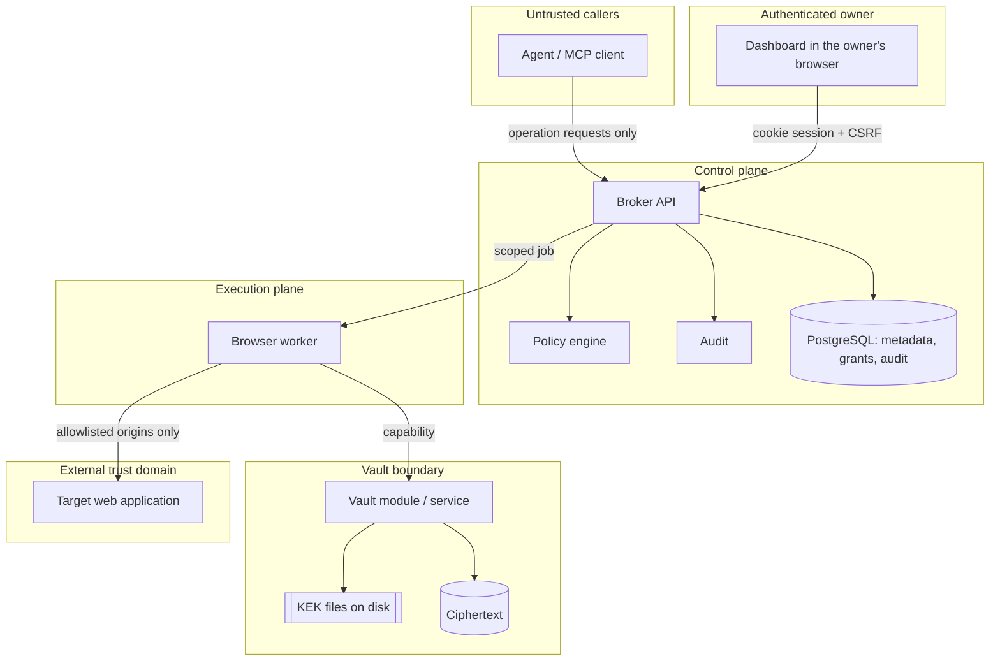

# ADR-001: Trust boundaries and worker isolation

- **Status:** Accepted
- **Date:** 2026-11-11

## Context

Agent Access Broker (AAB) lets an AI agent run narrowly defined operations on a user's accounts in
other web applications. The agent is driven by a language model, and a language model can be
steered by any text it reads, including text that comes back from the applications it operates on.
The design therefore has to hold even when the agent is actively trying to exceed its authority.

Three questions had to be settled before any code: who is allowed to hold authentication material,
which components sit on which side of each boundary, and how strongly the browser worker is
isolated in the first deliverable slice. The last question matters because the strongest form
(containers with default-deny network egress) needs Docker, and the development machines for this
project do not all have it.

## Decision

### The agent is never a credential holder

An agent asks for an operation. It does not receive, and has no interface for requesting, a
password, cookie, token, browser storage state, vault ciphertext, wrapped key, or a debugging
connection to a browser. Every other decision in this record follows from that rule.

### Three planes

- **Control plane.** The broker API, policy engine, audit trail and the relational metadata. It
  authenticates callers, evaluates policy, records decisions and creates jobs. It never returns
  secret material and never needs plaintext secrets to do its work.
- **Execution plane.** Workers that run adapter code against a target application. A worker holds
  plaintext session material in memory for the duration of one job. This is unavoidable: something
  has to present the cookie. The security claim is that the _model_ is isolated from secrets, not
  that no process ever sees them.
- **Vault boundary.** The code that turns ciphertext into plaintext, and the key-encryption keys
  (KEKs) that make that possible. It releases plaintext only to a worker that presents a capability
  scoped to one job, one connection and one operation.

The target application is a separate trust domain even when it is our own demo. Nothing it returns
is trusted as an instruction.

### Isolation level by phase

> **Superseded for Phase 2 and Phase 3 by [ADR-013](ADR-013-per-job-sandbox-egress-proxy.md)
> (2026-11-12).** The owner brought worker isolation forward: from Phase 2 every job runs in its own
> sandbox with no network, behind an egress proxy. The table below is kept as the original decision.

| Phase                                | Worker isolation                                                                                                                                                                                                                                      | What it does and does not give                                                                                                                                                                                                                        |
| ------------------------------------ | ----------------------------------------------------------------------------------------------------------------------------------------------------------------------------------------------------------------------------------------------------- | ----------------------------------------------------------------------------------------------------------------------------------------------------------------------------------------------------------------------------------------------------- |
| 1                                    | No worker exists. The control plane, the policy engine and the scoping rules are built and tested.                                                                                                                                                    | Nothing can execute against a target application.                                                                                                                                                                                                     |
| 2 (first slice)                      | The browser worker is a **separate operating-system process** from the API. Each connection has its own browser profile directory. The browser is launched without a remote-debugging port reachable by anything other than the worker that owns it.  | Separates address spaces and browser state. It does **not** provide a network-level egress boundary: navigation is restricted by the worker's own allowlist check, which is application-layer enforcement inside the process that is being protected. |
| 3 and anything beyond one local user | The worker runs in a **container** with default-deny egress, a read-only root filesystem, no host mounts other than its scratch directory, and no access to KEK files. The vault is a separate service; the worker reaches it only with a capability. | Adds a boundary that survives a compromised worker process.                                                                                                                                                                                           |

Docker is not required to develop or to run the test suite. Container isolation is a deployment
requirement that arrives with the vault service in Phase 3, and it is mandatory before AAB is used
by more than one person on a single trusted machine.

### Non-negotiable invariants

Each invariant is written so that a test can fail it. The "From" column is the phase in which the
invariant becomes enforceable because the component it constrains exists. An invariant is not
considered met until the named test exists and passes.

| #      | Invariant                                                                                                                                                                                                                                             | From | How it is checked                                                                                                                                                                                                               |
| ------ | ----------------------------------------------------------------------------------------------------------------------------------------------------------------------------------------------------------------------------------------------------- | ---- | ------------------------------------------------------------------------------------------------------------------------------------------------------------------------------------------------------------------------------- |
| INV-1  | No response, tool schema, tool result, log line or audit record reachable by an agent contains a password, cookie value, bearer token, storage state, ciphertext, nonce, wrapped key or KEK.                                                          | 2    | Plant unique canary strings as the demo session cookie and demo password; run every operation and every error path; search all agent-visible output, application logs and audit metadata for the canaries.                      |
| INV-2  | An operation request with no matching, unexpired, unrevoked allow grant is rejected before a job is created and before the vault is contacted.                                                                                                        | 4    | Request an ungranted operation; assert a deny decision, zero rows in the job table and zero vault access records.                                                                                                               |
| INV-3  | Policy is evaluated on the server for every operation request and again immediately before execution. No allow decision is cached across requests.                                                                                                    | 4    | Allow, enqueue, revoke the grant, then let the job run; the job must not execute.                                                                                                                                               |
| INV-4  | An applicable deny grant produces a deny decision whatever allow grants exist and in whatever order they are stored.                                                                                                                                  | 1    | Policy-engine unit tests permute grant order.                                                                                                                                                                                   |
| INV-5  | A repository call made with one owner's scope never returns or changes a row that belongs to another owner or organization, and the caller cannot distinguish "exists but not yours" from "does not exist".                                           | 1    | Create two owners in two organizations; attempt every read and write across the boundary; assert identical not-found results.                                                                                                   |
| INV-6  | A worker capability is valid for exactly one job, one connection, one operation and a bounded time. The vault rejects it for anything else and after expiry.                                                                                          | 3    | Present a capability for connection A when asking for connection B; replay an expired capability.                                                                                                                               |
| INV-7  | No agent-callable tool accepts a URL, a selector, a script, a file path or a shell command. Every navigation, including every redirect hop, is checked against the exact origins registered for the application.                                      | 2    | Schema inspection of every published tool; adapter-SDK navigation-guard tests with lookalike hosts, userinfo tricks, port changes and scheme downgrades; a demo redirect to a non-allowlisted origin must abort the operation.  |
| INV-8  | Secret material is persisted only as AES-256-GCM ciphertext bound by associated data to its organization, owner, connection, secret and version. KEKs are never stored in the database, the repository, a container image or an environment variable. | 2    | Crypto tests for tampered ciphertext, tag, nonce, wrapped key and each associated-data field; a start-up test that refuses a KEK file with group or world permissions; a repository scan for key material in continuous checks. |
| INV-9  | An approval authorizes one canonical action payload, for one agent, run and connection, once, until it expires. A modified payload, a second use, an expired approval or a changed target resource is rejected.                                       | 4    | The four rejection cases in the acceptance matrix.                                                                                                                                                                              |
| INV-10 | If the policy engine, the vault, the approval store or the audit store is unavailable or returns an error, the operation is not executed. A state-changing API call and its audit event are committed in one transaction or not at all.               | 1    | Inject a failing audit append; assert that the mutation rolled back and the caller received an error.                                                                                                                           |
| INV-11 | Revoking a grant or a connection takes effect on the next policy evaluation. A revoked connection never becomes active again.                                                                                                                         | 1    | Lifecycle tests in `packages/contracts` (revoked is terminal); INV-3 test.                                                                                                                                                      |
| INV-12 | A write is reported as succeeded only after the adapter has verified its postcondition against the target application. Otherwise the result is `outcome_unknown`, and it is never retried automatically.                                              | 4    | Kill the worker after the demo accepts a write and before verification; assert `outcome_unknown` and no second write.                                                                                                           |
| INV-13 | Application code writes diagnostics only through the structured, redacting logger.                                                                                                                                                                    | 1    | ESLint `no-console` is an error in the root configuration; logger tests with secret-shaped fields.                                                                                                                              |
| INV-14 | Content read from a target application reaches an agent only as fields of an operation result that has passed the operation's output schema. It never changes which operation, connection, grant or approval the broker applies.                      | 2    | The Northstar seed data contains an order note written as an instruction to the agent; a run that reads it must produce exactly the same broker decisions as a run that reads a benign note.                                    |
| INV-15 | Browser state for one connection is never loaded into a browser context used for another connection.                                                                                                                                                  | 2    | Connect two Northstar accounts; each connection's operations must return only its own account's orders (acceptance scenario "User connects two accounts on same app").                                                          |

## Alternatives considered

- **Give the agent a restricted browser.** Hand the model a browser that is already signed in and
  constrain it with prompts or a URL filter. Rejected: the cookie jar is then inside the same
  context the model controls, and any page the agent reads can instruct it. No filter makes an
  authenticated general-purpose browser equivalent to a fixed list of operations.
- **Run adapters inside the API process.** Simpler, one process fewer. Rejected: a browser
  rendering a hostile page would share an address space with the session store and the policy
  engine, and the Phase 3 move to containers would be a rewrite instead of a change of launcher.
- **Require containers from the first slice.** This is the stronger position and it was considered
  seriously. Rejected for Phase 2 only, because the interactive login in
  [ADR-002](ADR-002-login-handoff-session-snapshots.md) shows a real browser window on the owner's
  desktop, which a container cannot do without display forwarding, and because it would make Docker
  a prerequisite for running the first end-to-end test. The cost of this choice is stated below.
- **A microVM per job.** Stronger than containers. Deferred: nothing in a single-user local install
  justifies the operational weight. It becomes a real option in Phase 10.

## Consequences

- In Phase 2 the egress allowlist is enforced by the worker itself. A worker process that is fully
  compromised by a browser exploit can reach any host the machine can reach and can read the
  plaintext session it was given. This is acceptable only because Phase 2 handles synthetic
  accounts on a demo application on the same machine. It is not acceptable for real accounts.
- Because Phase 2 has no vault service, the worker process, or a helper it starts, must be able to
  unwrap data keys, which means the KEK is readable by the user account that runs the worker. Phase
  3 removes this by moving key use behind the vault service.
- The specification's Phase 2 exit criteria say "no secrets appear in tool outputs/logs". That is
  INV-1 and INV-13, and it is achievable in Phase 2. The specification's §3.2 list of runtime
  isolation properties (default-deny egress, no access to process environment) is not fully
  achievable until Phase 3, and documents must not claim otherwise in the meantime.
- Every package that touches a boundary carries negative tests for the invariants it enforces. A
  phase is not complete while an invariant that became enforceable in that phase has no test.
- Moving the worker into a container in Phase 3 breaks the headed-browser login of ADR-002 unless
  the login step stays on the host. That interaction is unresolved and is recorded in ADR-002.

## Revisit when

- Any credential that is not synthetic is about to be stored. Container isolation, the vault
  service and an external review (specification Phase 3 caution) are preconditions.
- A second user account is added to an installation.
- The Phase 2 spike shows that a separate process cannot prevent the agent gateway from reaching
  the browser's debugging endpoint on the platforms we support.
