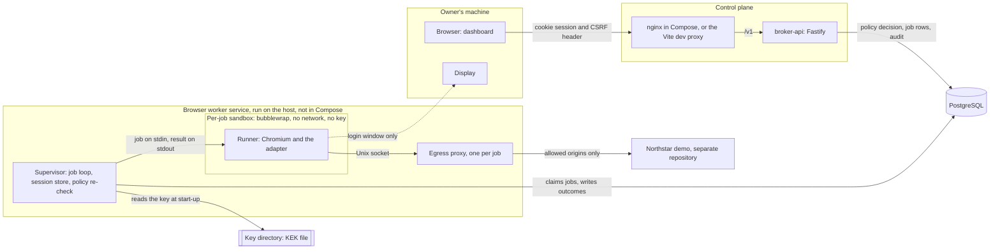
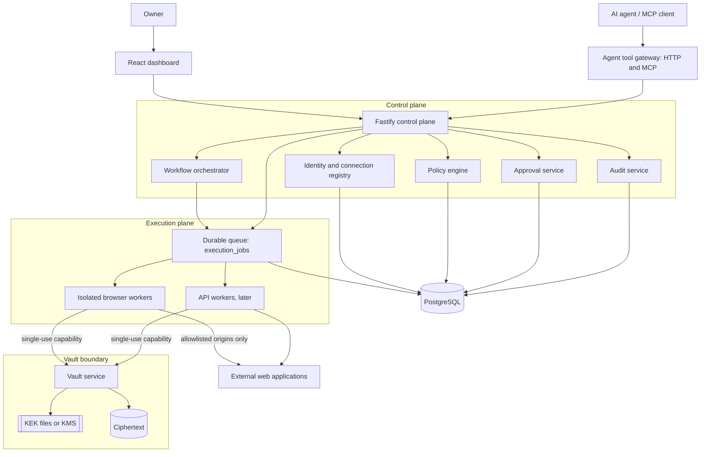
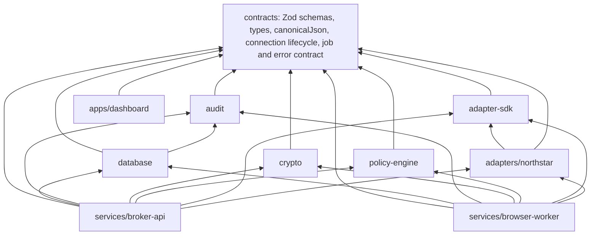
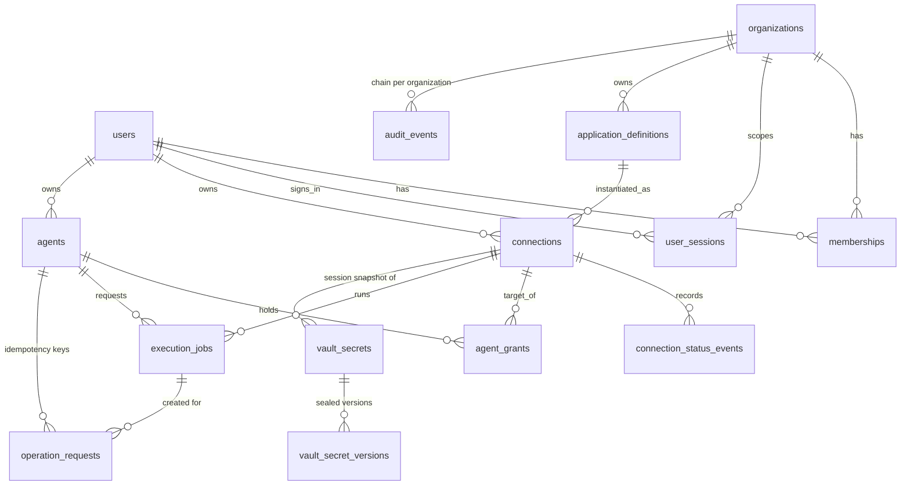
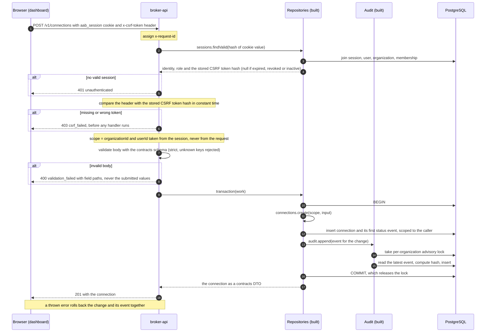
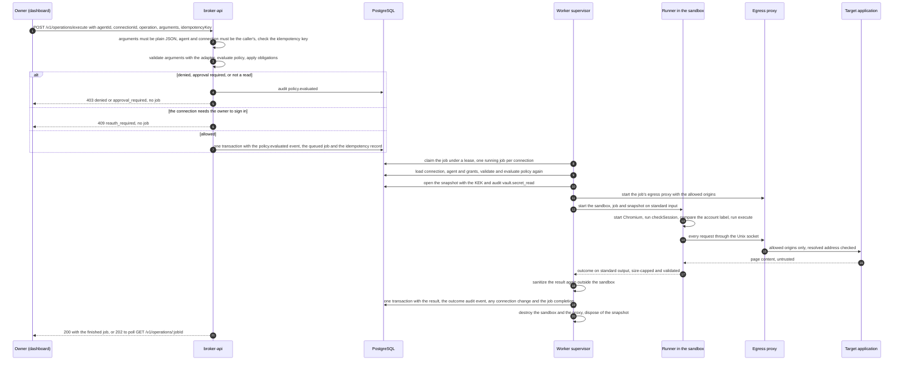
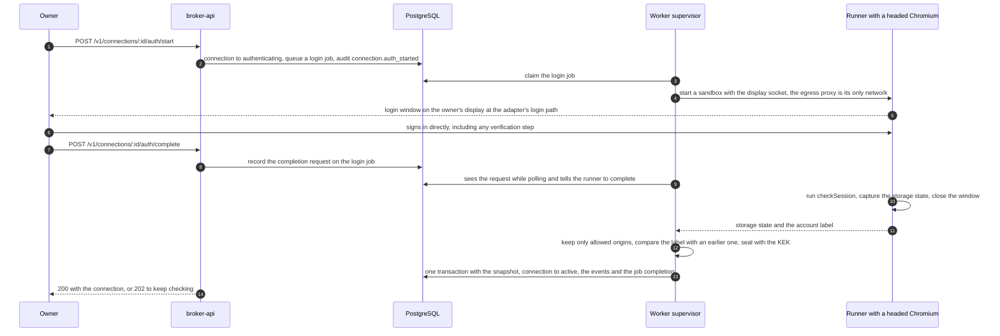
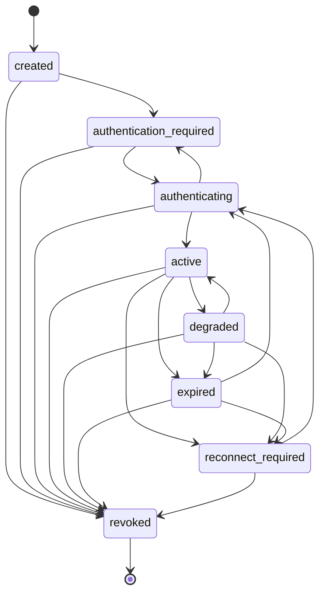

# Architecture

This document describes how Agent Access Broker (AAB) is put together. It separates what exists at
the end of Phase 2 from the target architecture of the specification (`docs/spec/aab-spec.md`,
version 0.3), because the two are still far apart and mixing them would overstate what the software
does.

How to read the labels:

- **Built** means the code exists in this repository and has automated tests.
- **Written, not run** means the code exists but has never been run in the environment it targets.
  The Docker launcher's opt-in mode (Chromium's own sandbox kept on, with a draft seccomp profile
  and no AppArmor profile) is in this state. The launcher's default mode and the container images were
  run by hand on 2026-11-13.
- **Planned** means a later phase of the specification. Nothing in that category exists.

Decisions and their reasons are in the architecture decision records in [`docs/adr`](adr/README.md).
This document refers to them and does not repeat them. The threat analysis and the security claims
are in [`threat-model.md`](threat-model.md) and [`security.md`](security.md).

## 1. What AAB is

AAB lets an AI agent run a fixed list of operations on a user's web applications without ever
holding the user's credentials. The agent asks for an operation. The broker decides whether the
agent has been granted it, optionally asks a human to approve the exact action, and has a trusted
worker perform it. The worker returns a minimal, sanitized result. The rule underneath everything is
that **an agent is not a credential holder**
([ADR-001](adr/ADR-001-trust-boundaries-worker-isolation.md)).

At the end of Phase 2 AAB can connect one synthetic application, store an encrypted session for it,
and run two read operations on it through a sandboxed browser, called by the signed-in owner acting
as one of their agents. It is still not a usable product: there is no vault service, no approvals, no
write operations, no agent credentials, no agent gateway and no MCP server.

## 2. The system today (end of Phase 2)

What the diagram shows and what it leaves out:

- The browser only ever talks to one origin. In development Vite proxies `/v1` to the API on
  loopback, and in the Compose draft nginx does the same. The session cookie and the CSRF check depend
  on that.
- The API is a thin layer. Every rule that matters sits in a library: scope checks and the connection
  lifecycle in the repositories, grant evaluation in the policy engine, hashing and redaction in the
  audit package. The API authorizes a request and creates a job row. It never opens a browser, reads a
  session snapshot or touches a key, and it runs without a key directory.
- The worker is a second service with its own process, environment and database connection. It claims
  job rows by polling PostgreSQL (`FOR UPDATE SKIP LOCKED`, one running job per connection); there is
  no queue library (spec changelog 0.3, item 41).
- The worker runs on the host, outside Compose. Compose runs PostgreSQL, the migration job, the API and
  the dashboard container only.
- The Northstar adapter now has `execute`, `checkSession`, `loginPath` and `sessionCheckPaths` for
  `orders.list` and `orders.get`. Both the API and the worker load it from a static registry. The API
  reads it as data (descriptors, schemas, the login path); only the worker runs its code.

### 2.1 The two worker roles

The worker service has two roles ([ADR-013](adr/ADR-013-per-job-sandbox-egress-proxy.md)):

| Role           | Lifetime    | Holds                                                                                          | Does not hold                                                         |
| -------------- | ----------- | ---------------------------------------------------------------------------------------------- | --------------------------------------------------------------------- |
| **Supervisor** | Long-lived  | The database connection, the KEK, the session store, the egress proxy and the sandbox launcher | A browser. It never parses a web page.                                |
| **Runner**     | One per job | One decrypted session snapshot, one validated operation, a browser, the adapter code           | The KEK, database credentials, any other connection's data, a network |

The supervisor treats the runner as untrusted. Everything the runner writes is read under a size cap,
checked as plain JSON, parsed with a strict schema and bounded; the runner's error text is thrown away
and replaced by a fixed message for the error code; and an operation result is passed through the
adapter's output schema again outside the sandbox. The wire protocol is newline-delimited JSON over
the runner's standard input and output (`services/browser-worker/src/protocol.ts`).

### 2.2 The sandbox

Each job, and each login window, gets a new sandbox that is destroyed when the job ends. With the
default `bubblewrap` launcher (`src/sandbox/bubblewrap.ts`) it has:

- its own network, PID, mount and IPC namespaces (`--unshare-all`) and no network interface except its
  own loopback;
- read-only mounts of only `node_modules`, `packages` and the worker's `package.json` and `src`, plus
  the system directories the runtime needs; files and directories whose names look like secrets
  (`.env*`, `*.pem`, `*.key`, `.git` and similar) are hidden by name pattern;
- memory-backed home and temporary directories, an empty environment apart from a few variables the
  runner needs, no capabilities, and Chromium's own sandbox switched on;
- the job on standard input, so the session snapshot is never on disk, in an environment variable or on
  a command line.

The other launchers are `docker` and `unsafe-process`. The `docker` launcher (`src/sandbox/docker.ts`,
image `infra/docker/browser-runner.Dockerfile`) was run on 2026-11-13. In its default mode it runs
the runner in a container with `--network none`, a read-only root, all capabilities dropped,
`no-new-privileges`, memory (1 GiB), CPU and process-count limits, tmpfs mounts owned by the job's
non-root user, and Docker's own seccomp and AppArmor profiles unchanged, with **Chromium's own sandbox
off**: the container is the only boundary around the browser. It refuses the login window, so a worker
that has only Docker cannot connect a new account, and the worker needs access to the Docker socket,
which is root-equivalent on the host. Its opt-in mode, which keeps Chromium's sandbox on, needs both a
seccomp profile and an AppArmor profile that permit user namespaces; the launcher refuses one without
the other and refuses `apparmor=unconfined`. The seccomp profile (`infra/docker/seccomp/browser-runner.json`)
is an unreviewed draft and no AppArmor profile exists, so that mode is not usable (AAB-017), and no
environment variable selects it. Bubblewrap has two layers (the sandbox and Chromium's own sandbox) and
no resource limits or seccomp filter; Docker's default mode has one layer and has resource limits.
`unsafe-process` (no isolation, only when named explicitly, warns on every job; no security statement
applies to it). bubblewrap applies no memory, CPU or process limit. The worker's start-up self-check
starts a real sandbox and Chromium and refuses to run if the sandbox has an interface besides loopback,
can reach the host's loopback, or cannot start the browser.

### 2.3 The egress proxy

The sandbox has no network, so the only way out is a Unix socket that the supervisor creates for the
job in a private directory and binds into the sandbox. A relay inside the sandbox listens on its
loopback and forwards to that socket; Chromium is told to use the relay for every request, loopback
destinations included. The proxy, which runs in the supervisor (`src/egress/proxy.ts`):

1. accepts a request only when its origin is exactly one of the job's allowed origins (the browser's
   own background traffic gets `403`);
2. resolves the host itself and refuses a non-loopback origin if any answer is a loopback, private,
   link-local, unique-local, CGNAT, multicast, unspecified or reserved address (`src/egress/ip-ranges.ts`);
3. connects to the address it checked, never to the name, so a changed DNS answer cannot redirect it;
4. tunnels HTTPS and WebSockets as `CONNECT`, checked when the tunnel opens and not again;
5. logs the origin, the decision and a reason code, never headers or bodies.

The proxy restricts origins, and that holds if the runner is compromised. Path restriction and
redirect checks are done by the browser facade inside the sandbox (`src/runner/facade.ts`) and do not.
A job's allowed origins are the intersection of the adapter's `allowedOrigins` and the application
definition's `allowed_origins`; if that is empty the job fails with `origin_not_allowed` before a
sandbox starts. That rule is provisional until the owner confirms it.

### 2.4 Where the key lives

The key-encryption key is a file in a directory outside the repository and the database
([ADR-003](adr/ADR-003-local-vault-root-key.md)). Only the worker's supervisor reads it, in its session
store (`src/session-store/index.ts`), which is the only code in the worker that seals or opens a
secret. The runner's sandbox does not mount the directory, the API is run without `AAB_KEK_DIR`
(it would load and permission-check a key directory if given one, but uses no key), and Compose does
not mount it anywhere. A test checks that only the session store and the scripts import
the crypto package and that the runner, sandbox and egress code import neither it nor the database
package. Until Phase 3 moves this behind a vault service, a compromised supervisor or host has the key
and every session.

The session store builds the encryption's associated data from the connection row it loaded, so a
ciphertext row moved to another connection, owner, secret or version does not open. Only the login
handoff writes a snapshot; an operation job never writes session state back.

## 3. The target architecture (specification section 3)

In this diagram the control plane's registry, policy library and audit library are built, and so are
the queue (as a polling loop over `execution_jobs`) and the browser worker. The vault service, the
approval service, the orchestrator, the agent gateway and API workers are **planned**. The target has
three planes with different jobs:

- **Control plane.** Authenticates callers, evaluates policy, records decisions, creates jobs. It
  never returns secret material and does not need plaintext secrets.
- **Execution plane.** Workers that run adapter code against a target application. A worker holds
  plaintext session material in memory for one job. The claim is that the _model_ cannot see it. The
  claim is not that no process ever does.
- **Vault boundary.** The only code that turns ciphertext into plaintext and the only reader of the
  key-encryption keys. It releases plaintext to a worker that presents a capability bound to one job,
  one connection and one operation.

The owner brought worker isolation forward into Phase 2: every job runs in its own sandbox with no
network, reachable only through the supervisor's egress proxy
([ADR-013](adr/ADR-013-per-job-sandbox-egress-proxy.md), which supersedes the isolation table of
[ADR-001](adr/ADR-001-trust-boundaries-worker-isolation.md) for Phase 2 and 3). The login window is a
sandboxed headed browser with the owner's display socket bound in
([ADR-002](adr/ADR-002-login-handoff-session-snapshots.md)); a containerized worker cannot show it in
Phase 2.

## 4. Package map

Dependencies are taken from each package's `package.json`. Workspace package names use the `@aab/`
scope.

| Package                       | Kind                | What it holds                                                                                                                                                                                                                                                                           | Depends on (workspace)                                                            |
| ----------------------------- | ------------------- | --------------------------------------------------------------------------------------------------------------------------------------------------------------------------------------------------------------------------------------------------------------------------------------- | --------------------------------------------------------------------------------- |
| `packages/contracts`          | Library, the bottom | Every shared schema and type, the error codes, the `Routes` constant, `OperationDescriptor`, the policy request and decision, `CONNECTION_TRANSITIONS`, `canonicalJson`.                                                                                                                | none (Zod)                                                                        |
| `packages/audit`              | Pure library        | `computeEventHash`, `verifyChain`, `redactMetadata`. No I/O.                                                                                                                                                                                                                            | contracts                                                                         |
| `packages/crypto`             | Library             | `sealSecret`, `openSecret`, `rewrapSecret`, KEK providers, scrypt password hashing, token generation and hashing. The only file access is the local KEK provider, which reads key files. Used by the API for password and token hashing and by the worker's session store for sessions. | contracts                                                                         |
| `packages/policy-engine`      | Pure library        | `evaluate`: one function, no I/O, no clock of its own.                                                                                                                                                                                                                                  | contracts                                                                         |
| `packages/adapter-sdk`        | Pure library        | `defineAdapter`, `defineOperation`, input validation, output sanitization, the navigation guard, the adapter registry, the `BrowserSession` and `WorkerContext` interfaces.                                                                                                             | contracts                                                                         |
| `packages/adapters/northstar` | Adapter             | Operation definitions, UI selector constants, `execute` and `checkSession` for the synthetic demo. Read operations only.                                                                                                                                                                | contracts, adapter-sdk                                                            |
| `packages/database`           | Library with I/O    | Drizzle schema, SQL migrations, the migration runner, repositories, PGlite test helper (`@aab/database/testing`).                                                                                                                                                                       | contracts, audit                                                                  |
| `services/broker-api`         | Service             | Fastify control plane: owner login and sessions, the resource routes, `POST /v1/operations/execute`, `GET /v1/operations/:jobId` and the login handoff routes. Creates jobs; never runs a browser or reads a key.                                                                       | contracts, database, audit, crypto, policy-engine, adapter-sdk, adapter-northstar |
| `services/browser-worker`     | Service             | The supervisor (job loop, session store, policy re-check, egress proxy, sandbox launchers) and the runner (browser facade, login and operation drivers) that runs inside the sandbox.                                                                                                   | contracts, database, audit, crypto, policy-engine, adapter-sdk, adapter-northstar |
| `apps/dashboard`              | Web app             | React 19, Vite, TanStack Query. Talks to the API through a typed client and never to the database.                                                                                                                                                                                      | contracts                                                                         |

Rules that the graph encodes:

- **`contracts` is at the bottom and imports nothing from the workspace.** It is the only interface
  between packages (specification §22.1). If one package needs something from another, the contracts
  change first.
- **The pure libraries do not depend on the database or on each other.** `audit`, `policy-engine` and
  `adapter-sdk` can be tested and reasoned about alone. The database package depends on `audit` because
  appending an event computes its hash.
- **The dashboard cannot reach the database.** It depends on `contracts` only, and everything it
  receives is parsed with a contracts schema before it is rendered.
- **`broker-api` and `browser-worker` both depend on `adapter-sdk` and the Northstar adapter.** The
  API reads adapters as data: policy descriptors come from `toOperationDescriptors`, input schemas
  validate arguments, and `loginPath` tells it whether a login can start. Only the worker runs
  adapter code, and only the runner, inside the sandbox.
- **Key handling stays in one module.** Only the worker's session store and its scripts import
  `@aab/crypto`; the runner, sandbox and egress code import neither it nor the database package. A
  test enforces this (`test/session-store/import-boundary.test.ts`).
- Each package has one writer at a time. Nobody edits another package to make their own compile.

Planned packages: `services/vault-service` (Phase 3),
`packages/agent-gateway` (Phase 6), `services/orchestrator` (Phase 7), `packages/observability` (when a
second service needs it).

## 5. Data model

Phase 1 created ten tables ([ADR-010](adr/ADR-010-tenant-ready-schema.md) explains the scope
columns). Phase 2 adds four (migration `0003_phase2_execution.sql`): `execution_jobs`,
`operation_requests`, `vault_secrets` and `vault_secret_versions`.

- `audit_events` refers to agents, connections, runs and actors by ID without foreign keys, so the trail
  outlives rows that retention may later delete.
- `agent_grants` and `connection_status_events` have no organization or owner column. They inherit scope
  from their agent and connection.
- `user_sessions` stores hashes of the session token and of the CSRF token, never the tokens.
- `execution_jobs` holds both operation jobs and login jobs (`kind`). It carries the lease, the attempt
  count, the policy decision ID, the stored result (sanitized fields only, set to null after
  `AAB_JOB_RESULT_TTL_MINUTES`) and the ID of the audit event that recorded the outcome. At most one
  login job per connection is non-terminal.
- `operation_requests` maps an agent and an idempotency key to a job, with a hash of the request.
- `vault_secrets` and `vault_secret_versions` hold the session snapshots: ciphertext, nonce, tag, the
  wrapped data key and the key version, never plaintext. Deleting a connection's secret removes the
  version rows and keeps the metadata row.
- Approval and workflow tables are created by later migrations, in the phase that introduces the code
  that maintains them.

## 6. Request path: a dashboard mutation

This is the path the API follows for a state-changing request from the dashboard, for example creating
a connection or revoking a grant. The steps follow the specification (§12.1) and the contracts, and
the Phase 1 API tests cover them (acceptance matrix AT-026 to AT-029 and AT-034). This section was not
re-read line by line against `services/broker-api` when Phase 2 was documented.

The properties this path is meant to have:

1. **Identity comes from the cookie, never from the request body.** The cookie is HttpOnly. Only a hash
   of the session token is stored, and an unknown, expired, revoked or deactivated session returns the
   same `unauthenticated` response.
2. **CSRF is checked before any handler.** The session response carries a CSRF token which the dashboard
   keeps in memory only. A missing or wrong `x-csrf-token` on a state-changing request is rejected with
   `csrf_failed`.
3. **Scope is resolved once and passed explicitly.** Every repository call takes the `Scope`
   `{ organizationId, userId }`. A row outside the scope is indistinguishable from a missing one, so the
   caller gets `not_found` in both cases.
4. **The change and its audit event are one transaction.** If the audit append fails, the change is
   rolled back and the caller receives an error (INV-10). The audit append should be the last statement
   of the transaction, because the advisory lock is held until the transaction ends.
5. **Errors have one shape.** Repository errors (`not_found`, `conflict`, `invalid_transition`,
   `validation_failed`) are mapped to the contracts `ErrorResponse`. Anything else is `internal_error`.
   Messages contain no row contents and no submitted values.
6. **Every response carries `x-request-id`**, which the dashboard shows to the user so a failure can be
   found in the audit log and the service logs.

## 7. Operation path

### 7.1 From `POST /v1/operations/execute` to the audit event (Phase 2)

This is the path of a read operation, called today by the signed-in owner who names one of their own
agents (spec §8.3, §12.2). Writes, approvals, agent credentials and the gateway are not part of it.

Step by step, with where each rule lives:

1. **The API checks before it creates anything** (`services/broker-api/src/routes/execution.ts`). The
   arguments must be plain JSON; the agent and the connection must both be the caller's (a missing and
   a foreign id both answer `404 not_found`, with no audit event); the idempotency key either returns
   the existing job or conflicts if the body differs.
2. **Policy.** The arguments are validated against the adapter's input schema, the policy engine
   evaluates the request with the grants, and obligations (such as a `maxResults` clamp) are applied
   and validated again. A deny, an approval requirement or an operation that is not a read creates no
   job. A connection that only needs the owner to sign in again gives `409 reauth_required`; a caller
   without a grant cannot tell the connection's state.
3. **One transaction** writes the `policy.evaluated` event, the queued job (holding the final
   arguments) and the idempotency record.
4. **The worker does not trust the job row.** The supervisor loads the connection, application, agent
   and grants itself and evaluates policy again (INV-3); a revoked grant, a disabled agent, an inactive
   connection or an operation that is not a read ends the job as `denied` or `cancelled` before any
   snapshot is opened.
5. **Exactly one snapshot** is opened, for this connection, and the read is audited
   (`vault.secret_read`) before the runner starts.
6. **The sandbox runs the job.** Inside it the facade checks every navigation and redirect hop against
   the operation's allowed paths; `checkSession` runs first, a changed account label ends the job with
   `identity_mismatch`, and a navigation that lands on the login path means the session expired
   (`reauth_required`). The adapter's result passes `sanitizeOperationOutput` before it leaves.
7. **The supervisor treats the outcome as hostile**, sanitizes the result again, and writes the
   result, the outcome event (`operation.succeeded`, `operation.failed`, `operation.denied` or
   `operation.reauth_required`) and any connection change in one transaction. If that fails the result
   is not kept and the job is left to lease recovery (INV-10). A `reauth_required` or identity outcome
   moves the connection to `expired` or `reconnect_required` and deletes its stored ciphertext
   (`vault.secret_deleted`).
8. **The API waits** up to `AAB_JOB_WAIT_MS` (default 20 seconds) for the job: `200` with the final
   job, or `202` with the job still `queued` or `running`.

A job whose worker dies is recovered by its expired lease: a retry-safe read is requeued (up to three
attempts), anything else ends as `outcome_unknown`. Lease recovery writes its audit event in a second
transaction, which a crash can interrupt (backlog AAB-019).

Invariants this path satisfies, with the tests in the
[acceptance matrix](acceptance-test-matrix.md) (the numbers refer to
[ADR-001](adr/ADR-001-trust-boundaries-worker-isolation.md)):

- An ungranted request is rejected before a job exists and before any key is used (INV-2, AT-003).
- Policy is evaluated on the server for every request and again before execution, and no decision is
  cached (INV-3, AT-053).
- If the audit store cannot record an outcome, the result is not kept (INV-10, AT-054).
- Page content reaches the agent only as fields of a result that passed the output schema, and never
  changes which operation, connection, grant or approval the broker applies (INV-14, AT-011).

### 7.2 The login handoff

The owner's sign-in is typed into the target application's own page; AAB reads no form field,
listens to no input and takes no screenshot. If the window is closed, the handoff passes 10 minutes,
the owner presses complete before signing in, or the adapter's session check fails, nothing is stored
and the connection returns to `authentication_required` with a reason. A re-login that signs in as a
different account than the recorded one is refused (`identity_mismatch`). With X11 the sandboxed
browser is a client of the owner's display and could see input to other windows while the window is
open; Wayland does not allow that. The handoff was tested on a private Xvfb display only, not on a
desktop session or on Wayland (threat model SB-11).

### 7.3 What the full path adds later (planned)

The specification's path (§8.3) also has an approval service, single-use scoped worker capabilities
from a vault service, postcondition checks for writes, `outcome_unknown` for unconfirmed writes and
agent credentials through the gateway. **None of that exists.** Until agents have credentials
(Phase 6), the execute endpoint is called only by the signed-in owner.

## 8. Connection lifecycle

The state machine below is `CONNECTION_TRANSITIONS` in `packages/contracts/src/connection-lifecycle.ts`,
edge for edge. Any transition not drawn is rejected by `canTransitionConnection`, and the repository
throws `InvalidTransitionError`.

- **Twenty transitions in total.** `revoked` has none going out. It is terminal: a revoked connection
  is never reactivated, and the owner creates a new connection instead.
- A connection becomes `active` only from `authenticating` or `degraded`. No path skips authentication.
- Operations execute only on `active` or `degraded` connections
  (`EXECUTABLE_CONNECTION_STATUSES`). In any other state the broker denies the operation before a
  worker is involved, or answers `reauth_required` when the owner can fix it by signing in again.
- Every transition is made by one repository function. It locks the connection row, so two concurrent
  transitions cannot both start from the same state, validates the move, updates the row and writes one
  `connection_status_events` row with the reason and the actor, in one transaction.
- Who triggers transitions today: the owner can create a connection and revoke it, and start a
  sign-in (`created` or `expired` or `reconnect_required` to `authenticating`, passing through
  `authentication_required` from `created`). The worker moves `authenticating` to `active` when a
  handoff completes, back to `authentication_required` when it fails, `active` to `expired` when the
  application rejects the stored session, and `active` to `reconnect_required` on an identity
  mismatch. `degraded` and the move from it are in the table but nothing in Phase 2 sets it.

## 9. Trust boundaries by phase

| Boundary             | End of Phase 2                                                                                                                                                                                                                                                 | Planned                                                                                                                                                     |
| -------------------- | -------------------------------------------------------------------------------------------------------------------------------------------------------------------------------------------------------------------------------------------------------------- | ----------------------------------------------------------------------------------------------------------------------------------------------------------- |
| Agent to broker      | No agent interface exists. The signed-in owner calls the execute endpoint as one of their agents.                                                                                                                                                              | Phase 6: per-agent credentials, grant-filtered tool discovery ([ADR-007](adr/ADR-007-mcp-authentication-discovery.md), proposed).                           |
| Owner to broker      | Cookie session, CSRF header, rate limiting and the first-owner bootstrap are built and tested against the in-process database; the end-to-end test ran them against PostgreSQL 18.                                                                             | OIDC and roles in Phase 10.                                                                                                                                 |
| Broker to worker     | Job rows in PostgreSQL. The worker re-evaluates policy with grants it loads itself; reads only.                                                                                                                                                                | Approvals and writes in Phase 4; orchestration in Phase 7.                                                                                                  |
| Supervisor to runner | One sandbox per job (bubblewrap): no network, no key, no database credentials, read-only mounts, empty environment. Job on standard input, outcome on standard output, treated as hostile. Docker launcher: default mode run, with Chromium's own sandbox off. | A reviewed seccomp and AppArmor pair for the Docker opt-in mode, resource limits for bubblewrap jobs, a seccomp filter (backlog AAB-017, AAB-018, AAB-024). |
| Worker to secrets    | The supervisor reads the KEK and calls the crypto library directly through the session store. The runner receives one decrypted snapshot for one job.                                                                                                          | Phase 3: vault service, single-use capabilities, the KEK out of the supervisor.                                                                             |
| Worker to target     | The egress proxy allows only the job's exact origins and checks resolved addresses; the facade checks paths and redirect hops inside the sandbox. A compromised runner is held to the origins, not to the paths.                                               | Subresource path limits are not planned; the origin limit is the control.                                                                                   |
| Tenant to tenant     | Scoped repositories and isolation tests exist ([ADR-010](adr/ADR-010-tenant-ready-schema.md)). One organization in practice.                                                                                                                                   | Phase 10, with independent verification.                                                                                                                    |
| Audit integrity      | Hash chain and verification library exist ([ADR-009](adr/ADR-009-audit-integrity.md)); the chain verified in the end-to-end run. No route verifies.                                                                                                            | Export to a protected sink. Not designed.                                                                                                                   |

## 10. Packaging

`infra/compose.yaml` describes four services: PostgreSQL, a one-shot `migrate` job, the API, and the
dashboard container. They share an internal network with no route out. The dashboard is also attached
to a second network, which exists only so that it can publish its port, and it is the only service
that publishes one, on loopback. The containers drop all capabilities, run with a read-only root filesystem and have
resource limits. The file is validated with `docker compose config` in CI. On 2026-11-13 the three
images (`aab/broker-api:local`, `aab/dashboard:local`, `aab/browser-runner:local`) were built and the
stack was started once by hand: PostgreSQL, `migrate`, the API and the dashboard came up healthy on the
first attempt and `127.0.0.1:8080` was the only published port. The checks that followed were manual
(see the threat model, section 6.1), not automated tests, and CI does not build the images or start
the stack (AAB-031). Two Dockerfiles needed a fix first: the API and runner images did not copy the
workspace packages added in Phase 2. It is still a draft for loopback use. **It has no worker service**:
the browser worker runs as a host process, and no container holds a key. The Docker launcher that runs
each job in a container uses its own image definition (`infra/docker/browser-runner.Dockerfile`), which
builds; its seccomp profile (`infra/docker/seccomp/browser-runner.json`) is used only by the opt-in
mode that is not usable. It does not build or start the Northstar
demo, which is a separate repository. In development none of this is needed: the tests run on in-process
PGlite and the dashboard runs under Vite
([ADR-011](adr/ADR-011-toolchain.md)).

## 11. Cross-cutting conventions

- **One schema language.** Zod 4 schemas in `packages/contracts` define every shape at every boundary.
  Types are inferred from them.
- **Canonical JSON for anything hashed.** Audit hashes, approval payload hashes, idempotent request
  hashes and encryption associated data all use `canonicalJson`, which rejects values that are not plain
  JSON instead of converting them.
- **Redaction at the edges.** Audit metadata passes through `redactMetadata` before it is stored.
  Application code writes diagnostics through the structured logger only, enforced by an ESLint
  `no-console` error.
- **Errors.** Every non-2xx response has the `ErrorResponse` body. General codes: `unauthenticated`,
  `forbidden`, `not_found`, `validation_failed`, `conflict`, `rate_limited`, `csrf_failed`,
  `service_unavailable`, `internal_error`. Operation outcomes: `denied`, `approval_required`,
  `reauth_required`, `retryable`, `outcome_unknown`. A job that did not succeed carries a closed set of job
  error codes (`JobErrorCode` in `packages/contracts/src/execution.ts`) with a fixed message per code;
  text from a page or from adapter code never becomes an error message.
- **Pagination.** List endpoints take `limit` (1 to 200, default 50) and an opaque `cursor` and return
  `items` and `nextCursor`. Cursors are validated and an altered cursor is a validation error.
- **Fail closed.** The policy engine never throws and denies anything it does not understand. A grant
  with constraints that cannot be read allows nothing, and a deny grant with unreadable constraints
  denies everything it names ([ADR-005](adr/ADR-005-policy-representation.md)).

## 12. Open design points

These are places where the specification, the decision records and the code do not yet agree, or where
the design has a gap that is visible in the code as written. Each needs a decision before the phase
that depends on it.

- **Two lists of allowed origins: provisionally decided.** A job may reach only the origins that are
  in both the adapter's `allowedOrigins` and the application definition's `allowed_origins`
  ([ADR-013](adr/ADR-013-per-job-sandbox-egress-proxy.md); changelog 0.3, item 36). The owner has not
  confirmed it. Registration still does not check that the named adapter exists.
- **Who calls `sanitizeOperationOutput`: decided.** The runner calls it, and the supervisor calls it
  again outside the sandbox. The `SanitizedResult` type is still not branded, so the type does not
  enforce it.
- **Login and the adapter contract: partly done.** The adapter now declares `loginPath` and
  `sessionCheckPaths`. ADR-002's list of identity-provider origins that may be visited during sign-in
  but never captured is not implemented, so only applications whose login stays on their own origin
  can be connected.
- **The adapter's `authMode` is one value.** The specification's interface has `authModes` as a list.
- **The worker split: decided.** The login window runs in a sandbox with the display socket bound in;
  the Docker launcher refuses it. How a hosted deployment would show a login window is Phase 10.
- **Subresource requests.** The proxy limits every request, subresources included, to the allowed
  origins. Paths on those origins are not limited for subresources or sub-frames; only main-frame
  navigations are checked against an operation's paths.
- **Session state is written by the login handoff only.** An operation job never writes a refreshed
  snapshot back. An application that rotates its session cookie on every request would need that to
  change (ADR-013, revisit conditions).
- **Audit verification has no entry point,** and the stored hash has no layout version
  ([ADR-009](adr/ADR-009-audit-integrity.md)).
- **The gaps recorded in the backlog** (AAB-017 to AAB-031): the Docker launcher's opt-in mode, resource limits, atomic
  lease recovery, CI for the sandbox tests, the dashboard against the real API, snapshot edge cases, a
  worker service in Compose and others.
