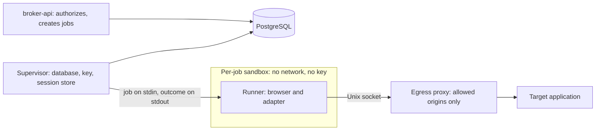

# Security

This document states what Agent Access Broker (AAB) claims about its security, what it does not
claim, which controls exist today, how to report a vulnerability, and the checklist every phase must
complete before it is called done. It is written for people who have not read the specification.

**Status: pre-release, synthetic data only.** AAB is at the end of Phase 2. It has a browser worker
that runs each job in its own sandbox, stores encrypted session snapshots, and can read two kinds of
record from one synthetic demo application for the signed-in owner. It has no vault service (the
worker reads the key directly), no approval workflow, no write operations and no agent interface. The
cryptographic code has **not been externally reviewed**. Do not connect it to real accounts, real
credentials or real business data, and do not rely on anything in this document as a guarantee for
such use.

The detailed threat analysis is in `docs/threat-model.md`, which is maintained separately. The
decisions behind the controls are in the [architecture decision records](adr/README.md). The system's
structure is in [`architecture.md`](architecture.md).

## 1. The security model in one paragraph

AAB lets an AI agent run a fixed list of operations on a user's web applications without the agent
ever holding the user's credentials. The agent can only ask for an operation. The broker checks the
request against explicit grants, and a trusted worker, not the agent, performs it using session
material the agent cannot read. The central rule is that **an agent is not a credential holder**. It
is a rule about the language model's reach. It is not a claim that nothing else ever touches a secret.

### The worker in Phase 2

The worker service has two roles ([ADR-013](adr/ADR-013-per-job-sandbox-egress-proxy.md)). The
**supervisor** is long-lived. It holds the database connection and the key-encryption key, creates one
egress proxy per job, and never runs a browser or parses a page. A **runner** exists for one job. It
runs the browser and the adapter inside a sandbox with no network interface, no key, no database
credentials and a read-only view of only the code it needs. It receives one decrypted session snapshot
and one validated operation on standard input and returns its outcome on standard output. The
supervisor treats what the runner returns as hostile: size-capped, parsed against a strict schema and
sanitized again outside the sandbox. The sandbox's only way out is a Unix socket to the egress proxy,
which accepts a request only for the job's exact allowed origins and checks the resolved address.



Where the key lives: in a file outside the repository and the database, read by the supervisor only,
in the session store module. The runner's sandbox does not mount it, the API is run without it (it would only
load and permission-check a directory it was given, and uses no key), and Compose does not mount it
anywhere. A compromised supervisor, host, kernel or sandbox escape reaches
it; that is outside what AAB claims.

## 2. What AAB claims, and what it does not

### What AAB claims, and the status of each claim

1. **The model receives no credentials or session tokens through the documented tool interface.**
   There is no tool, response field or error message that carries a password, cookie, token, browser
   storage state, ciphertext or key.
2. **Operations that were not granted are rejected by the broker,** on the server, before any worker
   runs, and an explicit deny always beats an allow.
3. **From Phase 2, a bounded claim about the runner:** a compromised browser or adapter inside a job's
   sandbox can use only the one session that job was given, only until the job ends, and can
   communicate only with that application's allowed origins. It cannot read the key-encryption key,
   the database or another connection's session.

Status on 2026-11-13, with the evidence in [`threat-model.md`](threat-model.md) section 6:

- Claims 1 and 2 are demonstrated for `POST /v1/operations/execute` and `GET
/v1/operations/:jobId` on the synthetic demo, called by the signed-in owner acting as one of their
  agents, for read operations. They are not demonstrated for a tool interface or an MCP gateway,
  which do not exist, or for writes and approvals. The evidence for claim 1 is an end-to-end scan that
  found none of the demo passwords, the owner password, the key bytes or the demo session tokens in
  logs, HTTP responses or any database column (`services/browser-worker/test/e2e/phase2.e2e.test.ts`,
  steps I1 and I2). It cannot find a secret it was not given, and a page can show a secret as ordinary
  text that a declared string field then carries.
- Claim 3 is demonstrated for the **bubblewrap** launcher only: by a probe run inside the real sandbox
  (`integration/isolation.test.ts`), by the egress proxy's tests (`egress-proxy.test.ts`,
  `ip-ranges.test.ts`), by cleanup tests (`integration/operations.test.ts`) and by the end-to-end test
  while a real job ran (step J). No real browser exploit was run, and no test replaces the runner with a
  hostile one. It is **not** demonstrated for the Docker launcher: its default mode has been run (five
  automated tests and a manual job, see section 5, item 3), but those tests do not cover the claim as the
  bubblewrap tests do, Chromium's own sandbox is off in that mode, and the end-to-end test has not been
  run with it.
  What it does not say is listed below and in the threat model.

### What AAB does not claim

- **That the worker never sees secrets.** The supervisor and the runner both hold plaintext session
  material in memory to use it, and the supervisor holds the key. AAB isolates the _model_ from
  secrets. It does not claim that no process ever sees them.
- **That a compromised supervisor, host, kernel or sandbox cannot reach sessions.** Encryption at rest
  protects against theft of the database on its own. It does not protect against someone who can read
  the key files as the service's user, against root, against a compromised supervisor (it holds the
  key until Phase 3) or against an escape from the sandbox.
- **That a compromised runner stays on an operation's allowed paths or returns true data.** The proxy
  limits a compromised runner to the allowed origins. Path and redirect restrictions are enforced
  inside the sandbox and do not survive a compromise. A compromised runner can make any request the
  session allows on those origins, send the session to them, and return false data that passes the
  output schema.
- **That jobs are resource-limited under bubblewrap.** A job is bounded by its timeout only. No
  memory, CPU or process limit and no seccomp filter apply. (The Docker launcher does limit memory,
  processes and CPU.)
- **That the Docker launcher is as strong as bubblewrap, or that it keeps a compromised browser
  renderer out of the runner.** In its default mode Chromium's own sandbox is off, so the container,
  with Docker's standard seccomp and AppArmor profiles, is the only boundary around the browser: one
  layer, where bubblewrap mode has two. Its opt-in mode that keeps Chromium's sandbox on is not usable
  (item 3 below).
- **That the sign-in window is safe from a compromised browser on X11.** During a login handoff the
  sandboxed browser is a client of the owner's display and could see input to other windows. Wayland
  does not allow that; the handoff was tested on a private Xvfb display only.
- **That all possible actions on a website are restricted.** The broker constrains broker-mediated
  actions. It cannot reduce what the target application allows the signed-in user to do, and a
  narrow broker grant does not narrow the account. If the account can delete everything, a bug in an
  adapter can delete everything.
- **That a model cannot be misled.** Text from a web page is treated as untrusted data and cannot change
  which operation, grant or approval the broker applies. A model that reads a hostile note can still
  be persuaded to ask for something harmful. What limits the damage is the grant: the agent can ask
  only for operations it was given, within its constraints, and a human sees the exact action when
  approval is required.
- **That the audit trail cannot be altered.** The trail is hash-chained, which makes partial edits
  evident to someone who verifies it. A database administrator can truncate the end or rewrite the
  whole chain, and the result verifies. Exporting chain heads to a protected sink is the mitigation and
  it is not built ([ADR-009](adr/ADR-009-audit-integrity.md)). There is currently no endpoint or command
  that runs verification.
- **That tenants are isolated from each other.** The schema and the repositories are written for it and
  tested for it. There is one organization in practice, and nobody independent has tried to break the
  boundary. Multi-tenant hosting is not offered ([ADR-010](adr/ADR-010-tenant-ready-schema.md)).
- **That the cryptography is reviewed.** It is built on `node:crypto` primitives with no homegrown
  cipher, and it has not been examined by an outside specialist. The package says so in its own README.
- **That secrets are cleared from memory.** Key buffers are zeroed on a best-effort basis. JavaScript
  cannot guarantee that no other copy exists in the runtime, the garbage collector or swap.
- **That a rolled-back database cannot be used against the vault.** An attacker who can write to the
  database could restore an older, valid sealed version of a secret. Detecting that is a vault service
  duty that does not exist yet.
- **Protection of data sent to model providers once a result has left AAB.** After a result reaches an
  external agent, AAB does not control where it goes ([ADR-008](adr/ADR-008-model-provider-data-classes.md),
  proposed).
- **Support for Windows** for anything that stores secrets. The key-file permission check relies on
  POSIX file modes ([ADR-003](adr/ADR-003-local-vault-root-key.md)).
- **Bypass of any control of the target application.** AAB does not defeat multi-factor
  authentication, CAPTCHA, conditional access or a site's terms. The owner signs in interactively.

### Company use

Using AAB with an organization's systems or data requires organizational authorization, and a review of
data handling, the model provider, automation policy and audit requirements. The project is not ready
for that, and the first conditions are in [ADR-001](adr/ADR-001-trust-boundaries-worker-isolation.md):
container isolation, a vault service and an external review.

## 3. Claims versus status (end of Phase 2)

| Claim or control                                                                                   | Status                                                                                                                                                                                                                                                                                                                                                                        |
| -------------------------------------------------------------------------------------------------- | ----------------------------------------------------------------------------------------------------------------------------------------------------------------------------------------------------------------------------------------------------------------------------------------------------------------------------------------------------------------------------- |
| Default deny; explicit deny wins; exact operation names; closed constraints                        | Built. `packages/policy-engine`, with tests that include grant-order permutation and malformed grants.                                                                                                                                                                                                                                                                        |
| Unknown or unreadable grant constraints fail closed                                                | Built, in the same package.                                                                                                                                                                                                                                                                                                                                                   |
| Server-side enforcement on every request                                                           | Built for the execute path and the login handoff routes (`services/broker-api`), and the worker evaluates policy again before each job. Writes and approvals are not built.                                                                                                                                                                                                   |
| No credentials in tool results, logs or audit records                                              | Verified for the execute path by an end-to-end scan of logs, HTTP responses and database columns (limits in section 2). There is no tool interface or gateway. Audit metadata redaction is built.                                                                                                                                                                             |
| Cross-owner and cross-organization isolation in the data layer                                     | Built and tested in `packages/database` and through the API routes. Not independently verified.                                                                                                                                                                                                                                                                               |
| Out-of-scope rows look like missing rows                                                           | Built and tested in the repositories and the API (the execute route answers 404 for another owner's agent or connection, without an audit event).                                                                                                                                                                                                                             |
| Envelope encryption: AES-256-GCM, a data key per secret version, bound associated data             | Built as a library, tested, not externally reviewed. Phase 2 stores real session snapshots with it; the associated data is rebuilt from the connection row on every open.                                                                                                                                                                                                     |
| Key-encryption key kept out of the database, with a permission check                               | Built (the local file provider refuses loose permissions and symbolic links). The worker loads it at start-up and refuses to start on an unsafe directory. POSIX only.                                                                                                                                                                                                        |
| Password hashing with scrypt, session tokens stored hashed                                         | Built and used by the API.                                                                                                                                                                                                                                                                                                                                                    |
| Hash-chained audit trail with per-organization serialization and redaction                         | Built. Detects partial edits. Does not stop a database administrator. No verification endpoint.                                                                                                                                                                                                                                                                               |
| Navigation allowlist guard and output sanitizer                                                    | Built in the adapter SDK and applied by the worker: every main-frame navigation and redirect hop inside the sandbox, and the output schema twice (inside and outside it).                                                                                                                                                                                                     |
| Network egress isolation for workers                                                               | Built for the bubblewrap launcher: no network interface in the sandbox, one egress proxy per job. The Docker launcher's default mode was run on 2026-11-13: its self-check passes (only `lo`, host loopback unreachable) and `integration/docker.test.ts` checks the container's properties; Chromium's own sandbox is off in that mode. No resource limits under bubblewrap. |
| Single-use scoped worker capabilities and the vault service                                        | Planned (Phase 3).                                                                                                                                                                                                                                                                                                                                                            |
| Approval of the exact action, single use                                                           | Planned (Phase 4).                                                                                                                                                                                                                                                                                                                                                            |
| Resolved-IP checks against SSRF and DNS rebinding                                                  | Built in the egress proxy and tested with an injected resolver. A tunnel is checked when it opens, not again. Registration still accepts hostnames that resolve privately; they are refused at connect time.                                                                                                                                                                  |
| `no-console` as an error, so output goes through the redacting logger                              | Built as a lint rule. The worker logs through its own redacting logger and never forwards runner stderr except fixed event names. Whether the loggers are complete is not yet reviewed.                                                                                                                                                                                       |
| Per-job sandbox: own namespaces, no capabilities, read-only code mounts, empty environment, no key | Built for bubblewrap; verified by `integration/isolation.test.ts` and the end-to-end test (step J). Secrets inside mounted code are hidden by file name pattern only.                                                                                                                                                                                                         |
| Runner output treated as hostile by the supervisor                                                 | Built: size cap, strict schemas, fixed error text, second sanitisation. Parsing is tested; no test runs a hostile runner through the whole path.                                                                                                                                                                                                                              |
| Session snapshots sealed, filtered to allowed origins, bound to their connection                   | Built in the worker's session store and tested, including moved and tampered ciphertext. Cookies on a parent domain are dropped.                                                                                                                                                                                                                                              |
| Ciphertext deleted on revocation, expiry and identity mismatch                                     | Built and tested (`supervisor/operation.test.ts`, `e2e/phase2.e2e.test.ts` steps G and H). A database backup taken earlier still holds it.                                                                                                                                                                                                                                    |
| Sandbox and end-to-end tests run in CI                                                             | Not done. They skip when their prerequisites are missing and CI does not run them.                                                                                                                                                                                                                                                                                            |

## 4. Controls that exist today

These are verified by tests in the repository unless the line says otherwise.

- **Policy evaluation.** One pure function decides every request. It denies on a malformed request, an
  unknown operation, an inactive agent, an inactive connection, a mismatch between the agent's owner and
  organization and the connection's, a missing grant, or an unsatisfied constraint. Any applicable
  deny grant wins whatever the allows say and whatever order they are stored in.
- **Scope in the data layer.** Repository functions take an explicit `{ organizationId, userId }`, filter
  by it in SQL, and report foreign rows as missing. Grants cannot join an agent and a connection that
  belong to different owners.
- **The connection lifecycle** is a fixed table of allowed transitions. `revoked` is terminal.
- **Audit.** Events are hash-chained per organization over canonical JSON, appended under a lock in the
  same transaction as the change, and redacted before they are stored.
- **Secrets at rest (library).** Authenticated encryption, associated data that includes the
  organization, user, connection, secret and version, a generic failure for every open error, strict
  checks on nonce and tag lengths, and a key store that refuses weak file permissions.
- **Adapter safety (library).** Strict input parsing that rejects unknown keys. Output schemas that
  cannot be loose. A navigation guard that rejects lookalike hosts, userinfo tricks, scheme downgrades,
  non-canonical spellings, path traversal and paths outside an operation's list. Error messages that never
  echo submitted values or page content.
- **Supply chain.** The package manager's minimum release age is left on. Dependency install scripts are
  allowlisted (esbuild only). The lockfile is committed and installs are frozen. CI audits shipped
  dependencies for high-severity advisories, scans the full history for secrets, and uses third-party
  actions pinned to commit hashes with read-only permissions and no secrets
  ([ADR-011](adr/ADR-011-toolchain.md), [ADR-012](adr/ADR-012-synthetic-only-dependency-review.md)).
- **Synthetic data only,** by rule and by the secret scan ([ADR-012](adr/ADR-012-synthetic-only-dependency-review.md)).

Phase 2 adds these controls. Worker tests are under `services/browser-worker/test/`; each control
names the test that proves it, and the threat model has the full evidence:

- **The execute path.** Arguments must be plain JSON and valid for the adapter, the agent and
  connection must be the caller's, policy runs with default deny, obligations are applied, and the
  decision, job and idempotency record commit together. An ungranted request creates no job
  (`services/broker-api/test/execution.test.ts`, "denies an ungranted read with no job row and a deny
  audit event (exit criterion)").
- **Policy again in the worker.** Grant revoked, agent disabled, connection revoked or inactive, and
  any operation that is not a read are refused before a snapshot is opened
  (`supervisor/operation.test.ts`, INV-3 block).
- **The sandbox.** No network interface but loopback, no key directory, home directory or database
  socket directory, an empty environment, read-only code, no capabilities
  (`integration/isolation.test.ts`; end-to-end step J).
- **The egress proxy.** Exact origins only, resolved addresses checked, connection to the checked
  address, request head, connection and idle limits (`egress-proxy.test.ts`, `ip-ranges.test.ts`;
  `integration/operations.test.ts`, "requests from page content to other origins are refused by the
  proxy and logged").
- **Navigation inside the sandbox.** Every main-frame request and redirect hop is judged before it is
  sent; a redirect to another origin or path, a meta refresh, a script navigation and a form
  submission end the operation (`integration/operations.test.ts`).
- **Hostile runner output.** Size cap, strict schema, fixed error text, second sanitisation
  (`protocol.test.ts`).
- **Sessions at rest.** Ciphertext only, bound to the connection, filtered to the allowed origins,
  deleted when the session ends (`session-store/session-store.test.ts`; end-to-end steps G, H and I1).
- **Identity.** A job for a different signed-in account than the one recorded ends with
  `identity_mismatch` before the adapter acts, and a re-login as another account is refused
  (`integration/operations.test.ts`; `supervisor/login.test.ts`).
- **Cleanup.** The sandbox and its runtime directory are gone when the job ends, times out, is
  aborted or hangs (`integration/operations.test.ts`; end-to-end step J).
- **No secrets leaked in a full run.** The end-to-end scan of logs, responses and database columns,
  with a positive control (steps I1 and I2).
- **Key isolation in code.** Only the session store and the scripts import the crypto package
  (`session-store/import-boundary.test.ts`).

## 5. Known limitations

The list is deliberately blunt. It will shrink as phases complete, and an item is removed only when the
check that closes it exists. Backlog tickets (AAB-017 to AAB-031) are in [`backlog.md`](backlog.md).

1. No vault service, approvals, write operations, agent credentials, agent gateway or MCP server exist.
2. The supervisor holds the key-encryption key and a database connection until Phase 3. A compromised
   supervisor or host reaches every session. A kernel or sandbox escape is out of scope.
3. The Docker launcher (`AAB_WORKER_SANDBOX=docker`) was run on 2026-11-13. As first written it did
   not work: the container's tmpfs mounts were owned by root, so Chromium could not start (fixed), and
   Chromium's own sandbox cannot run under Docker's defaults on that host (the default seccomp profile
   blocks user namespaces, and Docker's default AppArmor profile denies them even with the
   repository's custom seccomp profile). Its default mode therefore keeps Docker's own seccomp and
   AppArmor profiles and runs Chromium with its own sandbox **off**: the container is the only
   boundary around the browser, so a compromised renderer is a compromised runner inside the
   container. In this mode the self-check passes, a real `orders.list` job against the Northstar demo
   succeeded once by hand, and memory (1 GiB), CPU and process-count limits apply. The opt-in mode
   that keeps Chromium's sandbox on needs both a seccomp profile and an AppArmor profile that permit
   user namespaces; `infra/docker/seccomp/browser-runner.json` is an unreviewed draft written from
   memory and never compared with Docker's published default, no AppArmor profile exists, and no
   environment variable selects the mode, so it is not usable. Headed login is refused under Docker,
   so a worker that has only Docker cannot connect a new account, and the end-to-end test has not been
   run with the Docker launcher. The worker needs access to the Docker socket, which is root-equivalent
   on the host. The Compose file has no worker service. Trade-off: bubblewrap has two layers but no
   resource limits and no seccomp filter; Docker's default mode has one layer and resource limits.
   (AAB-017, AAB-023)
4. bubblewrap applies no memory, CPU or process-count limit, and no seccomp filter; nested user
   namespaces stay available because Chromium's own sandbox needs them. A job is bounded by its timeout
   only. (AAB-018, AAB-024)
5. The login window shares the owner's display. With X11 a compromised login browser could see input
   to other windows. Tested on a private Xvfb display only, not on a desktop session or on Wayland.
   (AAB-026)
6. Secrets inside the mounted code directories are hidden by file name pattern only. (AAB-025)
7. A compromised runner can make any request the session allows on the allowed origins, send the
   session there, and return false data that passes the output schema. Path and redirect restrictions
   run inside the sandbox and do not survive a compromise. No test runs a compromised runner. (AAB-028)
8. CONNECT tunnels and WebSockets have their resolved address checked when they open and not again.
   (AAB-027)
9. Lease recovery commits before its audit event is written; a crash between the two leaves a
   recovered job without an outcome event. (AAB-019)
10. A failed re-login leaves the previous snapshot ciphertext stored. A connection verified with no
    account label that later reports one is treated as an identity mismatch. Cookies scoped to a parent
    domain are dropped. (AAB-022)
11. Plaintext session state stays in the supervisor's heap until garbage collection and in the runner
    for the job's duration.
12. Job results (sanitized application data) are stored unencrypted in `execution_jobs.result` until
    purged after `AAB_JOB_RESULT_TTL_MINUTES` (default 60). (AAB-029)
13. A job may reach only origins in both the adapter's and the application definition's lists. This is
    provisional, awaiting the owner. Registration still accepts hostnames that resolve to private
    addresses (they are refused at connect time) and does not check that the named adapter exists.
    (AAB-030)
14. Continuous integration does not run the sandbox integration tests or the end-to-end test (they need
    bubblewrap with unprivileged user namespaces, Chromium, Xvfb, xdotool and PostgreSQL; the
    integration tests skip when the prerequisites are missing, and the end-to-end test runs only on
    request, and the Docker tests skip without a Docker engine and the image). CI has never run on a
    hosting service, does not build the container images and does not start the Compose stack. The
    images and the stack were built and started once by hand on 2026-11-13 (the checks, including
    those that close F-4, F-5 and F-9 as configuration-only claims, are listed in the threat model,
    section 6.1; they were manual, not automated tests). Base images are pinned by tag and digest (2026-11-13).
    (AAB-020, AAB-031)
15. The dashboard's Phase 2 screens are tested against a mock API only and have not been looked at in
    a browser against the real API. The API's own unit tests run on the in-process database; its
    concurrent-idempotency test does not exercise real parallelism. (AAB-021)
16. The audit trail has no protected export and no verification entry point, and stored events do not
    record the hash layout version.
17. Redaction is heuristic. A secret under an innocent key name, or written into prose, is not recognized.
18. Several packaged defaults are for loopback use only. The Compose draft serves the dashboard over plain
    HTTP and sets the session cookie without the `Secure` attribute. It must not be exposed beyond
    loopback.
19. Tenant isolation is not independently verified, and role checks are not implemented in the data
    layer.
20. Nothing mechanically checks that fixtures contain only reserved hostnames and no personal data.
21. The repository has no licence file yet.

## 6. Reporting a vulnerability

> **This section is a placeholder.** The project has not yet designated a security contact or a private
> reporting channel. It must be replaced with real details before the first public release, and that
> replacement is an item on the release checklist in section 7. Until then, treat the process below as the
> intended shape and not as a working service.

**What to report.** Anything that lets a party do what AAB's claims say they cannot: an agent obtaining a
credential, cookie, token or key; an operation running without a matching grant; an approval being
replayed, modified or reused; one owner or organization reading or changing another's data; a navigation
reaching an origin outside an allowlist; plaintext secrets appearing in a log, an audit record, an API
response or a screenshot; a bypass of the audit chain that verification does not detect; a dependency
issue that reaches a shipped component.

**How to report.** Do not open a public issue, and do not post details in a public discussion.

- Contact: `<security contact to be set before the first public release>`
- Private channel: `<private vulnerability reporting on the code host, if enabled, or an encrypted
mailbox: to be set>`

Send a description of the problem, the version or commit, the steps to reproduce, and what an attacker
gains. **Do not include real credentials, real third-party data or the output of anyone else's account.**
A proof of concept against the synthetic demo is enough.

**What to expect.** The targets below are placeholders to be confirmed by whoever takes ownership of the
process.

| Step                                    | Target                                 |
| --------------------------------------- | -------------------------------------- |
| Acknowledge the report                  | `<to be set>` working days             |
| First assessment and severity           | `<to be set>` working days             |
| Fix or mitigation for high or critical  | `<to be set>`                          |
| Public disclosure, agreed with reporter | After a fix is released, `<to be set>` |

**Scope.** In scope: the code and documentation in this repository. Out of scope: the Northstar demo
application (a separate repository, intentionally ordinary), third-party services, social engineering and
denial of service by volume against a local installation.

**If a secret has been exposed,** the owner revokes the affected connection in the dashboard, signs out of
the target application, and rotates the key-encryption key following `docs/operations.md`. Exposure
handling for a secret that was committed is to revoke or rotate first and clean history second.

## 7. Per-phase security checklist

Every phase completes this checklist before it is called done (specification §22, rule 10). Copy the
template below into the phase's pull request or release notes, fill in every line with a result and a
reference, and do not delete lines. A line that does not apply says "not applicable" and why. A line that
is not done says so, and the phase is not done.

The checklist is completed by the author and then reviewed by a second person who did not write the
change. For Phase 3 onward, and before any real credential is handled, the review includes someone
qualified in the area the phase touches.

```markdown
# Phase N security checklist

Phase: N, name
Date:
Author:
Reviewer (not the author):
Commit or tag reviewed:

## 1. Scope

- [ ] What this phase adds, in one paragraph, and what it deliberately does not add.
- [ ] New components, endpoints, tables, tools, dependencies and trust boundaries are listed.
- [ ] `docs/architecture.md` shows the new components, separately from the planned ones.

## 2. Invariants

- [ ] Every invariant in ADR-001 that becomes enforceable in this phase is listed, each with the name of
      the test that fails if it breaks. An invariant with no test is not met.
- [ ] Invariants that were already enforceable still pass.

## 3. Threat model

- [ ] `docs/threat-model.md` is updated for the new assets, entry points and attackers.
- [ ] Each new abuse case has a negative test, or a recorded reason there is none.

## 4. Negative tests

- [ ] For every new operation, endpoint or tool: unauthenticated, wrong owner, wrong organization,
      wrong connection, wrong agent, expired, revoked and malformed requests are refused, and the
      refusal looks the same as "not found" where scope is involved.
- [ ] Tests exist for the cases the phase's exit criteria name.

## 5. Secrets and leakage

- [ ] Canary strings were planted where a secret could flow, and every output the phase produces
      (responses, tool results, logs, audit metadata, error messages, screenshots, traces) was searched
      for them.
- [ ] No credential, key, cookie or token is present in the source, fixtures, prompts, logs or commits
      (secret scan clean).
- [ ] New logging goes through the structured logger. No `console` use outside the allowed places.

## 6. Authentication and authorization

- [ ] Caller identity comes from a credential, never from a request field.
- [ ] Authorization is checked on the server, on every request, and again before execution where the
      phase has execution.
- [ ] Default deny holds. A new failure mode fails closed.

## 7. Data and tenancy

- [ ] New tables carry the organization and owner columns, or the reason they do not is written down.
- [ ] New repository functions take a scope, or are added to the unscoped list in ADR-010 with a reason.
- [ ] Cross-owner and cross-organization tests cover the new functions.

## 8. Cryptography and vault (if touched)

- [ ] Only standard primitives. No new construction without review.
- [ ] Tampered ciphertext, wrong context, wrong version, expired and revoked cases are tested.
- [ ] Key handling matches ADR-003. External review is recorded for any phase that handles real secrets.

## 9. Network, navigation and execution (if touched)

- [ ] Every navigation and every redirect hop goes through the navigation guard.
- [ ] Page content is treated as untrusted data. A prompt-injection fixture was run, and the broker's
      decisions are identical to a run on benign content.
- [ ] Output passed the operation's output schema before leaving the worker.
- [ ] Worker isolation matches what ADR-001 and ADR-013 require for this phase, and the document says
      what the isolation does not give.

## 10. Audit

- [ ] Every state change and every decision this phase adds writes an audit event in the same
      transaction.
- [ ] Event metadata contains summaries only. The redaction test covers the new fields.
- [ ] The phase states what it does and does not prove about the audit trail (ADR-009).

## 11. Dependencies and supply chain

- [ ] Each new or upgraded dependency has a completed review as in ADR-012, including install scripts and
      release age.
- [ ] The install-script allowlist is unchanged, or the change is justified.
- [ ] The dependency audit passes at the blocking threshold.

## 12. Claims review

- [ ] Every security statement in the README, this file, the architecture document and the operations
      guide was re-read against the code and the tests. Nothing claims more than the tests show.
- [ ] Differences between the specification, the decision records and the code are listed, and each has
      a decision or a ticket.

## 13. Remaining risks

- [ ] A list of known risks that remain, each with an owner and the phase that closes it.
- [ ] A statement of the data this phase is safe to use with. Until stated otherwise: synthetic only.

## 14. Sign-off

- [ ] Author: all lines above are filled in with results.
- [ ] Reviewer: I checked the evidence referenced above and did not rely on the author's summary.
- [ ] Open exceptions, if any, are accepted in writing with a date by which they will be closed.
```

### Release additions

Before the first public release, add these to the Phase 9 checklist:

- [ ] Section 6 of this document contains a real contact, a real private channel and confirmed response
      targets.
- [ ] A licence file exists and the dependency licences were checked against it.
- [ ] Penetration testing of the broker, worker and vault boundaries is done, and critical and high
      findings are fixed or explicitly block the release.
- [ ] The security claims in section 2 were compared with what the released version does, line by line.
