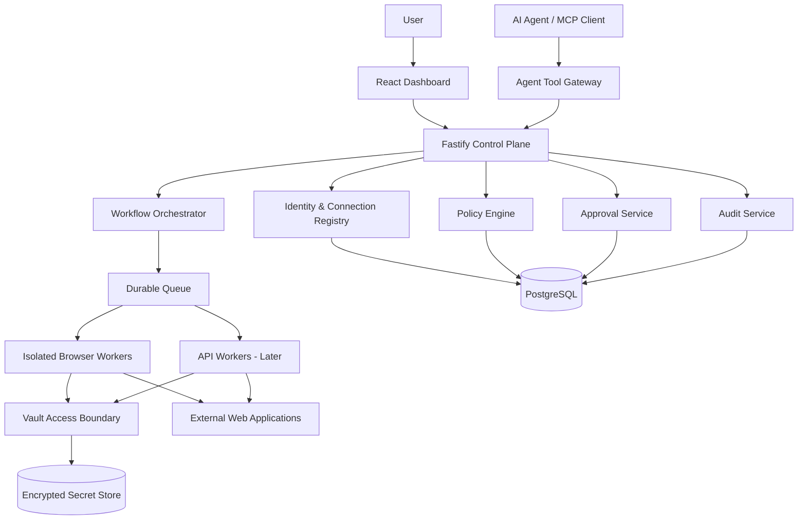
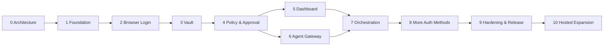

# Agent Access Broker (AAB)

## Product Requirements, Architecture, Technical Specification & Phased Implementation Plan

**Status:** Working specification; Phase 0 and Phase 1 implemented, Phase 2 in implementation  
**Version:** 0.3 (supersedes 0.2; every change and its reason is listed in [CHANGELOG.md](./CHANGELOG.md))  
**Date:** 2026-11-12 (version 0.1: 2026-11-11)  
**Primary stack:** TypeScript, Node.js, Fastify, React, PostgreSQL, Playwright  
**Deployment strategy:** Local-first, containerized; designed for future hosted multi-user operation  
**Repositories:** `agent-access-broker` (platform) and a separate `northstar-demo` (synthetic consumer)

Section numbers are the same as in versions 0.1 and 0.2. New material is added inside the existing sections or as new subsections at the end of a section, so references to 0.1 section numbers remain valid.

---

## 1. Executive Summary

Agent Access Broker (AAB) is a reusable platform that allows users to connect multiple web applications and delegate narrowly defined operations to AI agents **without putting passwords, cookies, OAuth refresh tokens, or other authentication secrets into the language model's context**.

AAB combines a management dashboard, connection registry, custom credential vault, policy enforcement, isolated browser/API workers, approval workflows, an agent orchestrator, and auditable execution records. The agent interacts with a catalog of approved tools, not with unrestricted authenticated browser control. AAB must support multiple accounts per application and multiple agents with different grants over the same account.

The synthetic demonstration application is a **separate project**. It exists to prove AAB can connect, authenticate, read, propose, approve, execute, and verify operations against a real application interface. The demo's domain model must never leak into the broker core.

### 1.1 Product outcomes

1. A user can create several connections to several applications, including multiple accounts for the same application.
2. A user can authenticate through an isolated browser handoff, or later through OAuth/API credentials.
3. Credentials and session material are stored encrypted and are accessible only to designated trusted services.
4. An agent can discover and invoke only the actions explicitly granted to it on a particular connection.
5. The broker enforces authorization **before execution** and rechecks applicable constraints at execution time.
6. Sensitive operations can require explicit human approval of the exact proposed action.
7. An orchestrator can execute multi-step, multi-application tasks with checkpoints, retries, cancellation, and recovery.
8. The dashboard displays connections, agents, vault items (metadata only), policies, approvals, workflows, and execution histories.
9. The platform runs locally with synthetic credentials and data, without any company systems or company data.

### 1.2 Non-goals for initial releases

- No universal ability to automate arbitrary websites without adapters.
- No guarantee that a target application's own permissions can be reduced by the broker; broker permissions constrain broker-mediated actions only.
- No arbitrary agent-authored Playwright scripts, direct CDP access, or general shell access.
- No password rotation on arbitrary websites until a specific adapter and recovery procedure exist.
- No custom cryptographic algorithm; custom vault refers to storage, key lifecycle, policies, and UX built around standard cryptographic primitives.
- No production-company credentials, confidential business data, or third-party service accounts during development.
- No multi-tenant SaaS launch in the first milestone, though tenancy boundaries are represented in the schema.

## 2. Product Boundaries and Actors

**AAB platform:** dashboard, API, authentication, application adapters, vault, policy engine, approvals, task orchestration, browser/API workers, audit trail.

**Demo application:** separate source repository, independently deployed, own database, synthetic users/orders/inventory, intentionally ordinary application authentication. It must not depend on AAB internals.

The first demo application, Northstar, is specified as follows so that broker tests have fixed behavior to rely on:

- It stores data in SQLite through Node's built-in `node:sqlite` module, so it runs with no external database.
- It renders HTML on the server and exposes a documented `data-testid` contract (kept in the demo repository's README). The Northstar adapter depends on that contract and on nothing else in the demo.
- It seeds two synthetic accounts, each seeing only its own orders. Their passwords are generated randomly each time the demo database is reset and are printed once; no password is committed.
- Orders carry a version number, and an edit submitted with a stale version is rejected. This is the target-side behavior that stale-approval detection (§8.2) relies on.
- The session lifetime is configurable, so session-expiry scenarios can be tested in seconds.
- One seeded order note contains a prompt-injection string. It is the fixture for the "malicious instruction in website content" scenario (§17).

**Actors:**

- **Owner/user:** creates connections, authenticates to applications, delegates permissions, approves operations.
- **Agent:** model-driven or deterministic client with a unique ID, tool grants, and run context.
- **Administrator:** initially the local owner; later an organizational role.
- **Broker API:** authenticates clients, validates requests, and coordinates policy/approval/execution.
- **Worker:** trusted process that holds short-lived access to session material and interacts with an external application.
- **Adapter:** versioned application-specific implementation of allowed operations.
- **Target application:** external trust domain, even when it is our own demo.

### 2.1 Fundamental trust rule

**An agent is not a credential holder.** It requests an operation. The broker evaluates the request. A trusted worker executes only approved operations using scoped access to the appropriate connection. The worker returns minimal, sanitized results. The LLM cannot retrieve vault contents, browser storage state, cookie headers, or raw browser debugging interfaces.

## 3. System Architecture



### 3.1 Control plane vs execution plane

**Control plane:** user and agent identity, connection metadata, policy evaluation, approvals, job creation, event logging, dashboards. Does not expose secrets in API responses or logs.

**Execution plane:** dedicated workers with restricted network/file access, time-limited session access, adapter code, browser instances, structured operation results. No access to unrelated connections.

**Vault boundary:** dedicated service/module with key hierarchy, ciphertext storage, access checks, and secret access audit. A trusted worker may need plaintext credentials/session tokens in memory; the claim is **model isolation**, not that no process ever sees plaintext.

### 3.2 Runtime isolation

- One worker job receives a scoped execution capability for one connection and one action; it cannot enumerate all vault entries.
- Browser profiles are isolated per connection and execution lease; never share cookies across connections.
- Use ephemeral workers where possible, persistent encrypted session snapshots where required.
- Prevent agent access to worker filesystem, CDP endpoints, network proxy controls, and process environment.
- Default deny network egress except configured application hosts and required identity-provider endpoints; validate redirects and DNS/IP behavior to reduce SSRF risk.
- Limit concurrent browser sessions and operations per connection.
- Do not put secrets in screenshots, traces, exceptions, telemetry, or model-visible tool results; redact and minimize artifacts.

**Allowlist rules.** These apply to every application definition and every adapter:

- An allowed origin is one exact scheme, host and port, for example `https://app.example.com` or `https://app.example.com:8443`. There are no wildcards, no paths, and no user information in the URL.
- HTTPS is required. The only exception is plain HTTP to a loopback host (`localhost`, `*.localhost`, `127.0.0.1`, `[::1]`), which the local demo applications use. IP-literal hosts other than the loopback addresses are rejected as allowed origins.
- Origins are validated when an application definition is registered, by the shared `Origin` schema, and again by the worker before it navigates.
- The worker checks the initial navigation and every redirect hop against the adapter's allowed origins and against the paths the operation permits (§7). A hop outside either stops the operation.
- The navigation guard accepts only an absolute URL that is already in the form a browser would normalize it to. It refuses, instead of repairing, a URL with an uppercase host, an explicit default port (`:443` for HTTPS, `:80` for HTTP), a backslash, whitespace or control characters, or a dot segment written literally (`.`, `..`) or percent-encoded (`%2e`, `%2f`, `%5c`). Refusing keeps the string that was checked identical to the string that is loaded, so a spelling that one parser reads differently from another cannot pass.
- The guard does not inspect query strings or fragments. An adapter that lets a query parameter or fragment steer the application to another resource, or to another host through a redirect parameter, must validate that value itself in its input schema (§7.1).
- From Phase 2 the worker also checks the resolved IP address of each host: it refuses private, link-local and other non-public ranges for non-loopback origins, and it connects to the address it checked, not to the name, so that a DNS answer that changes after validation (DNS rebinding) does not bypass the allowlist.
- A job may reach only the origins that are in both the adapter's list and the registered application definition's list. If the two lists share no origin, the job fails before a browser starts.

**Per-job sandbox (from Phase 2).** The worker service has two roles (ADR-013):

- The **supervisor** is long-lived. It holds the database connection, the session store and, until Phase 3, the KEK. It never runs a browser and never parses a web page.
- A **runner** exists for one job. It runs the browser and the adapter code inside a sandbox that has no network interface, a read-only filesystem without the repository's configuration files, the key directory or the home directory, an empty environment and no capabilities. It receives one decrypted session snapshot and one validated operation on standard input and returns the outcome on standard output. The sandbox is destroyed when the job ends.
- The sandbox's only way out is a Unix-domain socket to an **egress proxy** that the supervisor runs for that job. The proxy accepts a request only for the job's allowed origins and applies the resolved-address rules above. Origin restriction therefore holds even if the browser or the adapter is compromised. Path restriction and redirect checks are enforced by the browser facade inside the sandbox and do not survive such a compromise.
- The supervisor treats everything a runner returns as untrusted: it bounds the size, checks that it is plain JSON, validates it against a schema, and passes an operation result through the output schema a second time.
- An operation job does not write session state back. The stored snapshot changes only through the login handoff (§5.3).
- Local installs on Linux use bubblewrap; deployments with a container engine use a container with networking disabled. Running a job with no sandbox is possible only through an explicitly named unsafe setting meant for development, and none of the claims in §13.4 apply to it.

## 4. Technology Decisions

Versions in this table were verified against the package registry on 2026-11-11.

| Area               | Initial choice                                                                             | Rationale / alternatives                                                                                                              |
| ------------------ | ------------------------------------------------------------------------------------------ | ------------------------------------------------------------------------------------------------------------------------------------- |
| Language           | TypeScript 6.0.x (strict)                                                                  | Shared contracts across API, worker, dashboard. TypeScript 7 is current, but `typescript-eslint` supports only versions below 6.1     |
| Runtime            | Node.js 24 LTS                                                                             | Provides `node:sqlite` and `node:crypto` primitives used below                                                                        |
| Package manager    | pnpm 12 through Corepack, version pinned in `packageManager`                               | Minimum-release-age enforcement stays on; dependency build scripts run only for packages on an explicit allowlist (currently esbuild) |
| Backend            | Fastify 5                                                                                  | Typed request validation, plugin architecture; NestJS is an alternative                                                               |
| Frontend           | React 19 + Vite + TanStack Query                                                           | Responsive dashboard and predictable data fetching                                                                                    |
| Database           | PostgreSQL                                                                                 | Transactions, relational grants, JSONB metadata                                                                                       |
| ORM / migrations   | Drizzle ORM + SQL migrations                                                               | Explicit schema; Prisma also viable                                                                                                   |
| Test database      | PGlite (PostgreSQL compiled to WebAssembly, in process)                                    | The whole test suite runs without Docker or a database server                                                                         |
| Browser            | Playwright                                                                                 | Isolated contexts, browser automation, login handoff                                                                                  |
| Validation         | Zod 4, as the single schema strategy                                                       | Runtime input validation and inferred types; schemas live in `packages/contracts`                                                     |
| Queue              | PostgreSQL-backed queue initially                                                          | Fewer services; evaluate pg-boss or Graphile Worker                                                                                   |
| Advanced workflows | Temporal evaluation before Phase 7                                                         | Durable long-running orchestration; not mandatory from day one                                                                        |
| Agent integration  | HTTP tool gateway, MCP adapter                                                             | Separate core execution from any model provider                                                                                       |
| Vault encryption   | AES-256-GCM with per-secret-version data keys                                              | Standard authenticated encryption; avoid homegrown crypto                                                                             |
| Key protection     | Local key file for development (§6.4); KMS/HSM integration later                           | Do not store root key in database or repository                                                                                       |
| Authentication     | Local owner identity initially, password hashed with scrypt from `node:crypto`; OIDC later | No native password-hashing dependency to build; secure development, future multi-user support                                         |
| Audit              | Append-only logical events + integrity checks                                              | Useful traceability, not a claim of immutable storage                                                                                 |
| Telemetry          | OpenTelemetry-compatible structured events                                                 | Correlation across API, orchestrator, worker                                                                                          |
| Deployment         | Docker Compose                                                                             | Reproducible packaging for a local deployment. Compose is not needed to run the tests                                                 |
| Tests              | Vitest, Playwright, integration tests                                                      | Unit, contract, browser, security and E2E coverage                                                                                    |

**Decision gates:** Validate license, maintenance, compatibility, and threat model before adopting third-party components. Do not assume Temporal or a custom vault service is necessary for the earliest vertical slice.

## 5. Identity and Multi-Application Connection Model

### 5.1 Identity hierarchy

`Organization (future tenant) -> User -> Application Definition -> Connection -> Credential/Session Reference`

`Agent -> Grant -> Connection + Allowed Action + Constraints`

`Workflow -> Agent Run -> Steps -> Execution Attempts -> Audit Events`

- **Application definition:** adapter type, allowed origins, authentication methods, supported operations, adapter version. It belongs to one organization.
- **Connection:** a specific user's account on an application; several connections may share an application definition.
- **Credential entry:** vault-managed material associated with a connection, never returned in ordinary APIs.
- **Agent identity:** stable ID independent of the model provider or conversation.
- **Grant:** explicit binding of agent, connection, action, effect (allow or deny), conditions, expiry, and approval policy.
- **Run identity:** unique execution context, used to prevent permission leakage across tasks.

### 5.2 Connection lifecycle

`created -> authentication_required -> authenticating -> active -> degraded/expired -> reconnect_required -> revoked`

The line above is the usual path. The complete set of allowed transitions is the table below; it is the same data as `CONNECTION_TRANSITIONS` in `packages/contracts`, and any transition not listed is rejected.

| From                      | Allowed next states                                    |
| ------------------------- | ------------------------------------------------------ |
| `created`                 | `authentication_required`, `revoked`                   |
| `authentication_required` | `authenticating`, `revoked`                            |
| `authenticating`          | `active`, `authentication_required`, `revoked`         |
| `active`                  | `degraded`, `expired`, `reconnect_required`, `revoked` |
| `degraded`                | `active`, `expired`, `reconnect_required`, `revoked`   |
| `expired`                 | `reconnect_required`, `authenticating`, `revoked`      |
| `reconnect_required`      | `authenticating`, `revoked`                            |
| `revoked`                 | none                                                   |

- `revoked` is terminal. A revoked connection is never reactivated; the owner creates a new connection instead.
- A connection becomes `active` only from `authenticating` or `degraded`. No path skips authentication.
- Operations execute only on connections that are `active` or `degraded`. In every other state the broker denies the operation before any worker is involved, or returns `reauth_required` when the owner can fix it by signing in again.

Record status transitions with timestamps and reasons, one row per transition in `connection_status_events` (§11). Session health checks must not inadvertently perform destructive actions. A connection can be disabled without deleting historical audit records.

### 5.3 Authentication strategies

**Phase 1: Browser login handoff.** A user opens a broker-controlled browser session, authenticates directly with the target website (including MFA), and the worker captures necessary session state into encrypted storage. The LLM never participates in the login form. Never bypass MFA, CAPTCHA, conditional access, or a target's terms and policies.

The local mechanism, delivered in implementation Phase 2, is:

1. The owner starts authentication for a connection from the dashboard. The connection moves to `authenticating`.
2. The worker launches a headed browser on the owner's own desktop, with a fresh profile used only for this connection, and opens the application's login URL. That URL must be inside the application's allowed origins. The login browser runs in the same kind of sandbox as a job (§3.2), with the display socket added so that the window can be shown; its network still goes only through the egress proxy.
3. The owner signs in directly in that window, including any MFA. The broker does not read or record what is typed. Navigation stays subject to the allowlist rules in §3.2, with the identity-provider hosts the adapter declares as the only additions.
4. When the owner confirms in the dashboard that sign-in is complete (`POST /v1/connections/:id/auth/complete`), the worker runs the adapter's `checkSession` to confirm that a session exists and, where the application shows it, which account is signed in. The account label is stored as the connection's non-secret `external_account_hint`.
5. The worker captures storage state (cookies and origin storage) for the allowed origins only, seals it as described in §6, closes the browser and deletes the profile directory. The connection moves to `active`. If the owner closes the window or the check fails, the connection returns to `authentication_required` and nothing is stored.

This mechanism requires the worker and the owner to be on the same machine. Remote or hosted handoff, where the browser runs somewhere else and is shown to the owner, is out of scope until Phase 10.

**Later: OAuth authorization-code + PKCE.** Prefer delegated tokens with limited scopes where supported; securely handle refresh tokens, expiration, and revocation.

**Later: API key or service identity.** Store secrets in the vault and expose operations through validated API adapters.

### 5.4 Session requirements

- Encrypt browser state at rest; enforce strict filesystem permissions and no backups in plaintext.
- Keep cookies and tokens out of tool responses, application logs, screenshots, and agent context.
- Reauthenticate explicitly when sessions expire; never silently request the user's password from an agent.
- Support disconnect, revoke, delete, reauthenticate, and idle/session timeouts.
- Persist only necessary authentication state; avoid browser history and unrelated data.
- Treat captured session state as equivalent to a password for security purposes.
- Owner passwords are limited to 1024 bytes and may not contain a NUL character. scrypt starts with an HMAC step that zero-pads short keys, so a password ending in NUL would otherwise hash the same as the password without it. Such a password is refused when it is set and never matches at login. Each verification uses about 128 MiB of memory, so the API limits concurrent password verifications (two by default).
- A login for an account that does not exist still performs one password verification, against a fixed dummy hash with the same cost parameters, and returns the same error as a wrong password. Response time and response body therefore do not reveal which accounts exist. This reduces account enumeration through the login endpoint; it does not stop an attacker who can observe other channels.

## 6. Custom Vault Specification

### 6.1 Responsibilities

- Encrypt and persist credentials, refresh tokens, and session snapshots.
- Associate secrets with owner, connection, purpose, version, and lifecycle status.
- Return plaintext **only** to authorized worker code under a scoped capability.
- Support creation, replacement, rotation of encryption keys, revocation, and deletion.
- Record vault access metadata without recording secret values.
- Support secret versioning and safe rollback where appropriate.

The cryptography in §6.2 is implemented as a pure library, `packages/crypto`, that exists before Phase 2 and is used from the first stored session snapshot. Phase 3 adds the vault service boundary around it (§6.3): service identity, capabilities, versioning, rotation, revocation and the dashboard. Phase 3 does not introduce the encryption.

### 6.2 Cryptographic design

1. Generate a random 256-bit data-encryption key (DEK) per secret version.
2. Encrypt secret bytes with AES-256-GCM using a fresh random 96-bit nonce per encryption under that key.
3. Bind authenticated associated data (AAD) to organization, owner user, connection, secret ID, secret type, and secret version; reject mismatched context. The AAD bytes are the canonical JSON serialization (§11.2) of an object holding exactly those fields plus an integer AAD format version. The AAD format version is also stored beside the ciphertext, so the format can change without making old records unreadable.
4. Wrap the DEK with a key-encryption key (KEK) managed outside the database, using AES-256-GCM with its own fresh nonce. The wrap is bound to the same context as the secret plus the KEK version, so a wrapped DEK copied onto another secret or another version fails to unwrap. Store the wrapped DEK, data nonce, data tag, algorithm identifier, KEK version, AAD format version, and ciphertext. The wrapped DEK is one opaque value (for the local provider: wrap nonce, wrapped key and wrap tag together), and only the KEK provider interprets it, so a KMS-backed provider can replace the local one without a schema change. The algorithm identifier (`aab-envelope-v1/aes-256-gcm` for this construction) is stored with every version, so a different construction can be introduced later without making old records ambiguous. `kek_version` and `aad_version` are positive integers.
5. Restrict unwrap operations to vault service identity and authorized execution capabilities.
6. Support KEK rotation via rewrapping DEKs and DEK rotation via re-encryption; maintain explicit key versions.
7. Never log plaintext or key material, in any log, trace, error message or audit record.
8. Never reuse a nonce under the same key. Every encryption draws a fresh random 96-bit nonce, and because each secret version has its own DEK, each DEK encrypts exactly one message. A replacement or rotation creates a new version with a new DEK; it never re-encrypts under an existing DEK.
9. Never place keys in container images, Git history, test fixtures, or environment dumps.

**Threat boundary:** encryption at rest does not prevent plaintext exposure after full worker or host compromise. Isolate processes, minimize plaintext lifetime, restrict memory/debugging access, and use managed KMS for deployments beyond local development.

### 6.3 Vault API (internal only)

The vault receives plaintext from a trusted worker over a trusted internal channel and encrypts it itself. Callers never supply ciphertext, and the dashboard and agent gateway never call these functions with or for secret values.

- `createSecret(connectionId, type, plaintext)` — called by the worker that captured the material; returns metadata only.
- `replaceSecret(secretId, plaintext)` — versioned replacement; the previous version stays readable until the new one is committed.
- `issueAccessCapability(jobId, connectionId, operation, ttl)` — only after a policy decision that allows the job. The capability is bound to that job, connection and operation, expires after `ttl`, is single-use, and is persisted as a hash (§11) so that it can be revoked and audited.
- `readForWorker(capability)` — returns plaintext to worker over trusted channel; never to agent gateway. An expired, used, revoked or mismatched capability is rejected.
- `revokeSecret(secretId)` / `deleteSecret(secretId)` — revocation stops all further reads; deletion destroys every ciphertext version and wrapped DEK of the secret and keeps only the metadata row and audit history.
- `rotateWrappingKey(keyVersion)`.

No public endpoint named `getPassword` or unrestricted `listSecretsWithValues`.

In Phase 2, before the vault service exists, the worker's supervisor calls the crypto library directly through one storage module, and it is the only process that can read the KEK. The sandboxed runner that drives the browser never has the KEK (§3.2). Phase 3 moves that access behind the vault service and the capability check.

### 6.4 Local key-encryption key

For local installations the KEK is a file:

- One file per KEK version, containing 32 random bytes, in a directory outside the repository and outside the database (configured by path; nothing under the repository is accepted as a default).
- Key directory mode `0700` and file mode `0600`, owned by the user that runs the service. The service refuses to start if the directory or a key file is accessible to group or others.
- The key directory is mounted only into the vault service (Phase 3). The Phase 1 Compose file does not mount it into the API, because Phase 1 stores no secrets.
- The KEK version is recorded with every wrapped DEK, so several versions can be present during a rotation.
- The owner is responsible for backing up the key directory separately from the database. If a KEK is lost, every secret wrapped under it is unrecoverable and each affected connection must be reconnected. A database backup without the key directory restores metadata, not sessions.
- Deployments beyond a single local machine use a managed KMS or HSM through the same KEK provider interface (Phase 8 evaluation, Phase 10 requirement).

## 7. Application Adapter Contract

AAB is application-independent at its core, but individual websites require explicit adapters. Browser UI automation is brittle; adapters must be versioned and tested.

```ts
interface ApplicationAdapter {
  id: string;
  version: string;
  allowedOrigins: string[];
  authModes: Array<'browser_session' | 'oauth' | 'api_key'>;
  operations: Record<string, OperationDefinition>;
  checkSession(ctx: WorkerContext): Promise<SessionHealth>;
  execute(ctx: WorkerContext, operation: ValidatedOperation): Promise<SanitizedResult>;
}
```

`OperationDefinition` must specify input/output schemas, sensitivity (`read`, `write` or `destructive`), permitted navigation (the paths the operation may visit within the allowed origins), expected side effects, idempotency characteristics, timeout, and whether approval is required. Input schemas must validate without transforming, defaulting or coercing, so operation arguments must be supplied in canonical form. Where they exist, it also names the argument that identifies the target resource and the argument that bounds result size, because grant constraints (§8.1) refer to them.

The policy engine sees only a descriptor derived from each definition (`OperationDescriptor` in `packages/contracts`: name, sensitivity, `requiresApproval`, resource argument, limit argument). It never inspects adapter code.

The adapter receives a constrained browser facade through `WorkerContext`, not a raw Playwright page. The facade is where the navigation rules of §3.2 are enforced, so adapter code cannot bypass them by mistake.

**Examples:** `orders.list`, `orders.get`, `orders.proposeUpdate`, `orders.applyApprovedUpdate`.

### 7.1 Adapter safety constraints

- No arbitrary `evaluate`, `goto`, `fetch`, shell command, or script execution exposed as agent tools.
- All URL destinations validated against configured allowlists, including redirects, under the rules in §3.2. Query strings and fragments are outside what the guard checks, so an operation's input schema must not let free-form text become a query parameter or fragment that selects a different resource.
- Inputs schema-validated and escaped appropriately; avoid selectors or URLs constructed from untrusted free-form strings.
- Outputs are validated against the operation's output schema, and fields the schema does not declare are removed before the result leaves the worker. Only the validated result is ever shown to an agent. An output schema may not contain an object that lets undeclared fields through (a loose or pass-through object, or one with a catch-all); an operation whose output schema does is rejected when the adapter is defined, because it would defeat the removal of undeclared fields. Output schemas are checked against an allowlist of schema kinds; a kind not on the list is rejected.
- Browser workers verify current user/connection identity before acting where feasible.
- Validate target resource and current state immediately before a write; detect stale approvals.
- Verify postconditions after writes and report `unknown` when outcome cannot be confirmed.
- Never treat website text, emails, order notes, or HTML as trusted agent instructions.

## 8. Authorization and Approval Engine

### 8.1 Policy semantics

Default deny. Every operation requires a grant matching `agentId`, `connectionId`, `operation`, scope/resource constraints, time validity, and current user ownership. Explicit denies override allows. An agent's authority is the intersection of its grants, connection capabilities, adapter operation constraints, and the underlying target application's permissions.

A grant is one row: one agent, one connection, one operation, an effect (`allow` or `deny`), constraints, an approval mode (`none` or `required`), an optional expiry and an optional revocation time. The rules are:

1. **Exact operation names.** A grant names exactly one operation, such as `orders.list`. There are no wildcards and no prefixes.
2. **Closed constraint set.** The only constraints are:
   - `maxResults`: an upper bound on the operation's limit argument;
   - `argumentEquals`: each named argument must equal the given value;
   - `argumentOneOf`: each named argument must be one of the given values;
   - `resourceIds`: the operation's resource argument must be one of the given identifiers.

   A grant with any other constraint key is rejected when it is written. If such a grant is found in storage anyway, evaluation fails closed: an allow grant with constraints the engine cannot validate allows nothing, and a deny grant with such constraints denies everything it names. A constraint that cannot be enforced for the operation, such as `maxResults` on an operation with no limit argument, is treated as not satisfied.

3. **Evaluation order.** The engine denies if the request is malformed or names an operation the adapter version does not define; if the agent is not active; if the connection is not `active` or `degraded`; or if the agent and the connection do not belong to the same owner and organization. It then considers only grants for exactly this agent, connection and operation that are not revoked and not expired. A grant is expired from the instant `now` equals its `expiresAt`. If any applicable deny grant matches, the result is deny, whatever allow grants exist and in whatever order they were created. Otherwise at least one allow grant must have all its constraints satisfied; if none does, the result is deny.
4. **Approval.** An allowed operation still requires approval of the exact action (§8.2) if the allowing grant's approval mode is `required`, or the adapter marks the operation `requiresApproval`, or the operation's sensitivity is `destructive`. The last two apply regardless of the grant.
5. **Decision.** Every evaluation returns a decision with an outcome (`allow`, `deny` or `approval_required`), a stable reason code, a human-readable reason that contains no argument values, the IDs of the grants that produced the outcome, and obligations. Obligations are argument overrides the broker must apply before execution. For example, when a grant has `maxResults: 50` and the request omits the limit, the obligation sets the limit to 50; a request for more than 50 is denied as a constraint violation.
6. **One engine.** The policy simulator in the dashboard calls the same pure function as the execution path, so a simulated answer cannot differ from the enforced one.
7. **Arguments are plain JSON.** Operation arguments are checked as plain JSON before policy evaluation and again before execution. A key named `__proto__` at any depth, a cyclic structure, a value that is not JSON (undefined, non-finite numbers, class instances), or nesting deeper than a fixed bound (64 levels) makes the request invalid (`invalid_request`). The second check validates against the operation's input schema, which rejects unknown keys. The purpose is that the arguments a worker executes are exactly the arguments the engine judged: no parser along the path may drop, rename or reinterpret a key the engine saw.
8. **Deny grants.** A deny grant is read conservatively. It narrows itself only through `argumentEquals`, `argumentOneOf` and `resourceIds`, and only when the named argument is present in the request with a different value. If the argument is absent from the request, the deny still applies, because the engine cannot know what default the adapter would use. `maxResults` never narrows a deny. A deny grant whose constraints cannot be read denies everything it names.
9. **Grant times.** `expiresAt` and `revokedAt` are ISO 8601 UTC strings. An allow grant whose timestamp cannot be parsed is ignored. A deny grant is lifted only by an expiry or revocation that parses and has already passed; an unparseable timestamp leaves it in force.

Reason codes are `allowed`, `approval_required`, `no_matching_grant`, `explicit_deny`, `constraint_violation`, `agent_not_active`, `connection_not_active`, `ownership_mismatch`, `operation_unknown` and `invalid_request`.

Example, shown as the grant rows it produces (`orders.delete` would be denied even without the last row, because nothing allows it; the explicit deny makes sure a later allow cannot enable it by accident):

```yaml
agent: order-assistant
connection: northstar-primary
grants:
  - operation: orders.list
    effect: allow
    constraints: { maxResults: 50 }
    approvalMode: none
    expiresAt: 2027-01-01T00:00:00Z
  - operation: orders.proposeUpdate
    effect: allow
    approvalMode: none
    expiresAt: 2027-01-01T00:00:00Z
  - operation: orders.applyApprovedUpdate
    effect: allow
    approvalMode: required
    expiresAt: 2027-01-01T00:00:00Z
  - operation: orders.delete
    effect: deny
```

### 8.2 Approval design

- Present exact connection, operation, resource IDs, proposed changes, and expected effects.
- Approve a **canonicalized action payload hash**, not a generic permission to act. The hash is SHA-256 over the canonical JSON (§11.2) of the bound fields.
- Bind approval to user, agent, run, connection, action, expected resource version, and expiration.
- Single-use, atomic redemption; reject replay, modification, expired approvals, expired or revoked grants, and mismatched state. Redemption sets the consumption marker in the same transaction that creates the job.
- Re-evaluate policy immediately before execution; approval does not override a later revoke.
- If target state changed, require a new proposal and approval.

### 8.3 Authorization flow

`Agent request -> authenticate agent -> validate schema -> resolve connection -> evaluate policy -> (optional approval) -> enqueue signed/scoped job -> worker revalidates -> execute -> verify -> audit -> sanitized result`.

The caller's identity always comes from its credential. Until agents have their own credentials (Phase 6), `POST /v1/operations/execute` is callable only by the signed-in owner, who names one of their own agents to run the operation as; policy is evaluated for that agent exactly as it will be later. From Phase 6, an agent authenticates with its own credential, and an `agentId` in the request body that differs from the authenticated agent is rejected.

## 9. Agent Orchestration

### 9.1 Separation of concerns

The **orchestrator** chooses workflow steps and handles task state; the **broker** authorizes each external operation; the **worker** executes the approved operation. Never let orchestration code bypass the policy gateway.

### 9.2 Required features

- Create, start, pause, resume, cancel, and inspect runs.
- DAG/step-based tasks with typed inputs and outputs.
- Tool discovery filtered by agent-specific grants.
- Cross-application operations with separate grants per connection.
- Durable step checkpoints and idempotency keys.
- Retry transient failures with bounded exponential backoff; no blind retry of non-idempotent writes.
- Timeouts, concurrency limits, quotas, and circuit breakers.
- Human-in-the-loop approval and reconnect steps.
- Cancellation propagation to queued and active workers where feasible.
- Model-provider abstraction with budget, token, and cost limits.
- Structured result handling; sanitize sensitive business data before model exposure.

### 9.3 Workflow example

1. Agent reads held orders from demo Application A.
2. Agent checks inventory from demo Application B.
3. Agent produces a proposed correction.
4. Policy engine marks the write as approval-required.
5. User reviews exact changes in the dashboard.
6. Worker executes the approved operation and checks postconditions.
7. Orchestrator records completion, partial failure, or unknown result.

### 9.4 State machine

`queued -> running -> waiting_approval | waiting_reauth | retry_scheduled | paused -> running -> succeeded | failed | cancelled | outcome_unknown`

`paused` is entered only at a step boundary, by an explicit pause request, and left by an explicit resume. `succeeded`, `failed`, `cancelled` and `outcome_unknown` are terminal. A run can be cancelled from any non-terminal state.

Never label a write successful solely because Playwright returned without throwing.

## 10. Dashboard Product Specification

### 10.1 Navigation

1. **Overview:** connected apps, agent activity, pending approvals, failures, recent runs.
2. **Applications:** available adapters, supported authentication and operations.
3. **Connections:** connect/disconnect, status, session expiry, reauthenticate, per-account identity.
4. **Vault:** secret metadata, type, connection association, last use, rotation/revocation controls; never reveals plaintext.
5. **Agents:** register agents, model/runtime metadata, grants, allowed connections, budgets.
6. **Policies:** action/resource restrictions, approval requirements, expiry, policy simulation.
7. **Workflows:** create/launch workflows, step graphs, run status, retry/cancel.
8. **Approvals:** exact proposed action, diff, source agent, expiry, approve/deny.
9. **Activity & Audit:** filter by user, agent, app, connection, run, action, outcome, time.
10. **Settings:** local identity, key status, worker health, retention, model configuration.

### 10.2 Dashboard design principles

- Distinguish **connected**, **session expired**, **reconnect required**, **revoked**, and **worker unavailable**.
- Show authorization rationale and the policy/grant that caused allow/deny.
- Redact credentials, sensitive fields, and potentially secret-bearing screenshots.
- Display cost/token usage separately from business-action counts.
- Make pending approvals prominent; allow explicit deny and revoke.
- Provide an execution timeline: requested -> policy evaluated -> approved -> started -> verified.
- Accessibility: keyboard navigation, clear status text, semantic controls, responsive layouts.

## 11. Data Model (Initial Relational Schema)

All primary keys UUID unless specified. Every mutable entity has `created_at`, `updated_at`; sensitive tables include ownership/tenant boundaries.

The Phase column says which implementation phase creates the table. Phase 1 creates exactly the ten tables marked 1; later tables arrive as migrations in their own phases, so that no table exists before the code that maintains it.

| Table                       | Phase | Essential columns                                                                                                                                                                                             |
| --------------------------- | ----- | ------------------------------------------------------------------------------------------------------------------------------------------------------------------------------------------------------------- |
| `organizations`             | 1     | id, name, status (single local org initially)                                                                                                                                                                 |
| `users`                     | 1     | id, email, password_hash or oidc_subject, status                                                                                                                                                              |
| `memberships`               | 1     | organization_id, user_id, role                                                                                                                                                                                |
| `user_sessions`             | 1     | id, user_id, organization_id, token_hash, csrf_token_hash, expires_at, last_seen_at, revoked_at. Dashboard sessions; only hashes of the session and CSRF tokens are stored                                    |
| `application_definitions`   | 1     | id, organization_id, adapter_id, adapter_version, name, allowed_origins, auth_modes, status                                                                                                                   |
| `connections`               | 1     | id, owner_user_id, organization_id, application_id, display_name, external_account_hint, status, status_reason, last_verified_at                                                                              |
| `connection_status_events`  | 1     | id, connection_id, from_status, to_status, reason, actor_type, actor_id, created_at. One row per transition (§5.2)                                                                                            |
| `agents`                    | 1     | id, organization_id, owner_user_id, name, client_identity, status                                                                                                                                             |
| `agent_grants`              | 1     | id, agent_id, connection_id, operation, effect (allow or deny), constraints, approval_mode, expires_at, revoked_at                                                                                            |
| `audit_events`              | 1     | id, organization_id, sequence, timestamp, actor_type, actor_id, agent_id, run_id, connection_id, event_type, decision, metadata, previous_hash, event_hash                                                    |
| `operation_requests`        | 2     | id, agent_id, idempotency_key, request_hash, job_id, created_at; unique on (agent_id, idempotency_key). Stores the idempotency key sent in §12.2                                                              |
| `execution_jobs`            | 2     | id, organization_id, run_id, agent_id, connection_id, operation, input_ref, policy_decision_id, approval_request_id, capability_ref, status, attempt_count, lease_expires_at                                  |
| `vault_secrets`             | 2     | id, connection_id, secret_type, active_version_id, status, last_accessed_at                                                                                                                                   |
| `vault_secret_versions`     | 2     | id, secret_id, version, algorithm, ciphertext, nonce, auth_tag, wrapped_dek (one opaque value, §6.2), kek_version and aad_version (positive integers), created_at                                             |
| `vault_access_capabilities` | 3     | id, job_id, connection_id, operation, secret_id, token_hash, expires_at, used_at, revoked_at                                                                                                                  |
| `approval_requests`         | 4     | id, organization_id, run_id, agent_id, approver_user_id, connection_id, operation, action_hash, proposal_json, expected_resource_version, expires_at, status, consumed_at, consumed_by_job_id                 |
| `approval_decisions`        | 4     | id, approval_request_id, user_id, decision, decided_at                                                                                                                                                        |
| `agent_credentials`         | 6     | id, agent_id, token_hash, label, last_used_at, expires_at, revoked_at. Agent tokens are stored only as hashes                                                                                                 |
| `workflows`                 | 7     | id, owner_user_id, name, definition_json, version                                                                                                                                                             |
| `workflow_runs`             | 7     | id, workflow_id, agent_id, status, started_at, completed_at, cost_total                                                                                                                                       |
| `workflow_steps`            | 7     | id, run_id, step_key, state, attempt_count, result_ref, idempotency_key                                                                                                                                       |
| `policies`                  | —     | id, organization_id, policy_document, version, status. Not scheduled: per-agent grants express every rule in this specification. Whether organization-wide rules are wanted is an open question for the owner |

Notes on specific columns:

- `execution_jobs.policy_decision_id` is the ID of the `policy.evaluated` audit event that recorded the decision. Policy decisions are not stored in a separate table.
- `operation_requests.request_hash` is the hash of the canonical request. A repeated idempotency key with the same hash returns the original job; the same key with a different hash is a `conflict`.
- `approval_requests.consumed_at` is the single-use marker. Redemption is one conditional update inside the transaction that creates the job, so two concurrent redemptions cannot both succeed.
- `audit_events.sequence` increases by one per organization. `previous_hash` and `event_hash` chain events within one organization (§11.2).

### 11.1 Data integrity and privacy

- Enforce owner/organization foreign keys and uniqueness for connection names within owner scope where appropriate.
- Use database transactions for grant redemption, approval consumption, and job state changes.
- Never store secret plaintext in audit `metadata`, job payloads, or workflow definitions.
- Store sensitive operation inputs in access-controlled encrypted blobs or narrowly scoped tables; audit only redacted summaries.
- Support configurable retention and deletion of session artifacts and workflow inputs.
- Audit hashes provide tamper evidence under stated assumptions; a compromised database administrator can still delete records unless logs are exported to a protected sink.
- Every query on a tenant-owned table is filtered by the caller's organization and, where the table has an owner, by the owner. A row outside the caller's scope is indistinguishable from a missing row (§12.1).

### 11.2 Canonical serialization and the audit chain

Anything that is hashed (audit events, approval action payloads, idempotent request bodies, encryption AAD) is first serialized as canonical JSON in the style of RFC 8785: object keys sorted by UTF-16 code unit, no insignificant whitespace, ECMAScript number formatting. Values that are not plain JSON (undefined, NaN, infinities, big integers, dates, class instances, cycles, sparse arrays, symbol keys) are rejected, not coerced, because a silent coercion would let two different payloads share a hash. The implementation is `canonicalJson` in `packages/contracts`.

The audit chain works as follows:

- Each organization has its own chain. `event_hash` is SHA-256 over the canonical JSON of the event's fields together with `previous_hash`, which is the `event_hash` of the event with the preceding `sequence` in the same organization (null for the first).
- Appends are serialized per organization, by a transaction-scoped lock, so two concurrent appends cannot read the same previous hash or take the same sequence number.
- A database trigger rejects `UPDATE`, `DELETE` and `TRUNCATE` on audit events; a database superuser or the table owner can disable it.
- `metadata` is redacted before it is hashed and stored: values under keys that look like credentials (password, secret, token, cookie, authorization, API key, credential, private key, storage state, and `session` or `auth` as a whole key) are replaced, and long strings are truncated. Redaction is a safety net; callers are still required to pass only summaries.
- Verification recomputes the chain and reports the first event that was modified, removed or reordered.
- The limits are those stated in §11.1 and §4: the chain makes tampering evident to someone who verifies it, it does not prevent tampering, and someone who can rewrite the whole table can rewrite a consistent chain unless hashes are exported to a protected sink (ADR-009).

## 12. API and Tool Contracts

All APIs versioned under `/v1`. Authentication and authorization required except explicit health endpoints. OpenAPI generated from schemas.

### 12.1 Control plane API

The Phase column says when each endpoint is delivered.

```text
Phase 1
GET    /v1/health
POST   /v1/auth/login
POST   /v1/auth/logout
GET    /v1/auth/session
POST   /v1/applications/register       (admin/developer)
GET    /v1/applications
POST   /v1/connections
GET    /v1/connections
GET    /v1/connections/:id
POST   /v1/connections/:id/revoke
POST   /v1/agents
GET    /v1/agents
GET    /v1/agents/:id
POST   /v1/agents/:id/disable
POST   /v1/agents/:id/grants
GET    /v1/agents/:id/grants
DELETE /v1/agents/:id/grants/:grantId
GET    /v1/audit-events

Phase 2
POST   /v1/connections/:id/auth/start
POST   /v1/connections/:id/auth/complete
POST   /v1/operations/execute
GET    /v1/operations/:jobId

Phase 3
GET    /v1/vault/secrets                (metadata only)
GET    /v1/vault/secrets/:id            (metadata only)
POST   /v1/vault/secrets/:id/revoke

Phase 4
GET    /v1/approvals
POST   /v1/approvals/:id/approve
POST   /v1/approvals/:id/deny

Phase 7
POST   /v1/workflows
POST   /v1/workflows/:id/runs
GET    /v1/runs/:id
POST   /v1/runs/:id/cancel
```

These are target contracts. The Phase 1 paths are also defined as the `Routes` constant in `packages/contracts`. Use CSRF protections for cookie-authenticated dashboard mutations; rate-limit auth, approvals, and execution routes.

**Dashboard sessions.** `POST /v1/auth/login` takes an email and password and sets an HttpOnly session cookie (`aab_session`). The response, and `GET /v1/auth/session`, return the user, the organization, the session expiry and a CSRF token. A failed login returns one generic error whatever the cause, so the endpoint does not reveal whether an email exists; the password rules and the dummy verification for unknown accounts are in §5.4. There is no self-registration endpoint and no default password: the first owner account is created by an explicit local bootstrap command that reads the password interactively or from a file the owner names.

**CSRF.** Every cookie-authenticated request that changes state must carry the session's CSRF token in the `x-csrf-token` header. A missing or wrong token is rejected with `csrf_failed` before any handler runs.

**Errors.** Every non-2xx response has the same body (`ErrorResponse` in `packages/contracts`):

```json
{
  "error": {
    "code": "validation_failed",
    "message": "Request body is invalid.",
    "requestId": "request-id",
    "details": [{ "path": "displayName", "message": "Required" }]
  }
}
```

`code` is one of a fixed set. General codes: `unauthenticated`, `forbidden`, `not_found`, `validation_failed`, `conflict`, `rate_limited`, `csrf_failed`, `service_unavailable`, `internal_error`. Normalized operation outcomes, which are what an agent sees when an operation does not simply succeed: `denied`, `approval_required`, `reauth_required`, `retryable`, `outcome_unknown`. `details` lists field-level validation issues and never echoes a submitted secret value. Every response carries the request ID in the `x-request-id` header.

**Scope and not-found.** A request for a resource outside the caller's organization or ownership gets the same `not_found` response as a request for a resource that does not exist. The API never confirms that someone else's resource exists.

**Pagination.** List endpoints take `limit` (1 to 200, default 50) and an opaque `cursor`, and return `{ "items": [...], "nextCursor": "..." }`, where `nextCursor` is null on the last page.

### 12.2 Example operation request

```json
{
  "agentId": "agent-uuid",
  "connectionId": "connection-uuid",
  "operation": "orders.list",
  "arguments": { "status": "held", "limit": 25 },
  "runId": "run-uuid",
  "idempotencyKey": "client-generated-unique-key"
}
```

`agentId` is honored only as described in §8.3: the owner's session may name one of the owner's agents; an agent credential fixes the agent, and a different `agentId` in the body is rejected. `idempotencyKey` is stored in `operation_requests` (§11).

`POST /v1/operations/execute` answers in one of three ways. A request that policy does not allow gets an error response (`denied`, or `approval_required` until Phase 4 adds approvals) and no job is created. A request on a connection that needs the owner to sign in again gets `reauth_required` and no job is created. Otherwise a job is created and the API waits a bounded time for it: if the job finishes, the response is `200` with the job in its final status (§12.3; the status may be `succeeded`, `failed`, `denied`, `reauth_required`, `outcome_unknown` or `cancelled`); if not, the response is `202` with the job still `queued` or `running`, and the caller reads it later from `GET /v1/operations/:jobId`.

`arguments` must be plain JSON, checked as described in §8.1 rule 7 before policy evaluation and again against the operation's input schema before execution. A request that fails the first check is denied as `invalid_request`.

### 12.3 Example sanitized response

```json
{
  "jobId": "job-uuid",
  "status": "succeeded",
  "result": {
    "orders": [{ "id": "synthetic-1042", "status": "held" }]
  },
  "auditEventId": "event-uuid"
}
```

### 12.4 MCP integration

Expose only adapter operations authorized for the requesting agent and connection. MCP tools invoke the same broker policy/execution pathway as HTTP clients. MCP is **not** a privileged bypass. Do not publish a general-purpose `browser_execute_js` tool.

## 13. Threat Model and Security Requirements

### 13.1 Assets

User sessions, passwords, refresh tokens, encryption keys, account mappings, agent grants, approval records, application data, audit integrity, and worker execution capabilities.

### 13.2 Adversaries and failure modes

- Malicious or prompt-injected agent instructions.
- Untrusted website content masquerading as higher-priority instructions.
- Agent tool calls attempting to exceed grants.
- Compromised browser worker or malicious target page.
- Session theft from local disk, logs, traces, or backups.
- Approval replay, time-of-check/time-of-use races, and stale resource versions.
- Cross-connection and cross-user data access.
- SSRF through navigation/redirects and exfiltration to attacker domains.
- Partial writes, duplicate retries, and lost acknowledgements.
- Host compromise, malicious dependencies, and unsafe deployment defaults.

### 13.3 Mandatory controls

1. No secrets in LLM prompts, tool schemas, tool results, or agent-visible browser state.
2. Least-privilege per-agent grants scoped to specific connections and operations.
3. Server-side policy checks on every operation; deny by default.
4. Separate trusted worker process/container; no arbitrary agent code execution.
5. Encrypt secret storage with standard authenticated encryption and externalized KEK.
6. Short-lived worker capabilities and atomic, one-use approvals.
7. Network and navigation allowlists with redirect validation.
8. Audit authorization decisions, secret access metadata, approvals, execution outcomes, and revocations.
9. Redaction and retention controls for logs, screenshots, traces, and results.
10. Fail closed when policy, vault, or approval service is unavailable.
11. Explicit revocation behavior, including invalidating active worker leases where possible.
12. Test cross-user, cross-connection, and cross-agent isolation before any multi-user release.

Controls added by this version's decisions sit under the items above: exact-origin allowlists and resolved-IP checks under 7 (§3.2); the closed constraint set and fail-closed evaluation under 3 (§8.1); canonical hashing and metadata redaction under 8 and 9 (§11.2); KEK file permission enforcement under 5 (§6.4); caller identity taken from credentials under 3 (§8.3). Dependency installation is also a control against malicious dependencies (§13.2): releases younger than the package manager's minimum release age are not installed, and dependency build scripts run only for allowlisted packages.

### 13.4 Security claims and limitations

- **Can claim after verification:** the model receives no credentials/session tokens through the documented tool interface; unauthorized tool operations are rejected by the broker.
- **Can claim after verification, from Phase 2:** a compromised browser or adapter inside a job's sandbox can use only the one session that job was given, only until the job ends, and can communicate only with that application's allowed origins. It cannot read the key-encryption key, the database or another connection's session.
- **Cannot claim universally:** the worker never sees secrets, a compromised supervisor or host cannot access sessions, a kernel or sandbox escape is impossible, a compromised runner stays on an operation's allowed paths or returns truthful data, or all possible actions on a website are restricted independently of its own UI.
- **Company use:** requires organizational authorization and review of data handling, model provider, automation policies, and audit requirements.

## 14. Repository Structure

Directories marked (1) exist in Phase 1; the others are created in the phase that implements them. Workspace package names use the `@aab/` scope, for example `@aab/contracts` and `@aab/adapter-northstar`.

```text
agent-access-broker/
├── apps/
│   └── dashboard/                 # React management UI (1)
├── services/
│   ├── broker-api/                # Fastify control plane (1)
│   ├── browser-worker/            # Isolated Playwright executor (Phase 2)
│   ├── vault-service/             # Key/secret access boundary (Phase 3)
│   └── orchestrator/              # Workflow runner and queue consumer (Phase 7)
├── packages/
│   ├── contracts/                 # Shared Zod schemas, types, canonical JSON (1)
│   ├── database/                  # Schema, migrations, repository layer (1)
│   ├── policy-engine/             # Grants, constraints, decisions (1)
│   ├── adapter-sdk/               # Application adapter interfaces (1)
│   ├── adapters/
│   │   └── northstar/             # Demo adapter, not demo app source (1)
│   ├── audit/                     # Structured audit events, hash chain, redaction (1)
│   ├── crypto/                    # Envelope encryption, KEK providers, password and token hashing (1)
│   ├── agent-gateway/             # HTTP/MCP tool boundary (Phase 6)
│   └── observability/             # Logging and tracing (when a second service needs it)
├── infra/
│   ├── docker/
│   └── compose.yaml
├── tests/
│   ├── integration/
│   ├── e2e/
│   ├── security/
│   └── fixtures/
├── docs/
│   ├── spec/                      # This specification and its changelog
│   ├── architecture.md
│   ├── threat-model.md
│   ├── acceptance-test-matrix.md
│   ├── backlog.md
│   ├── adr/
│   ├── adapter-development.md
│   ├── operations.md
│   └── security.md
├── .github/workflows/
├── .env.example                   # No real credentials
├── package.json
├── pnpm-workspace.yaml
└── README.md

northstar-demo/                     # SEPARATE REPOSITORY
├── web/
├── server/
├── database/
├── seed/
├── tests/
└── compose.yaml
```

Unit and repository tests live beside the package they test. The top-level `tests/` directory is for tests that cross packages or need a running application.

## 15. Full Phased Implementation Plan

**Planning principle:** design for the complete platform, but deliver a runnable, testable vertical slice at each milestone. Phase numbers indicate dependencies, not fixed calendar dates. Estimated effort assumes one developer using AI coding assistance; complexity can shift substantially after spikes. The estimates are the owner's originals from version 0.1 and have not been validated against measured progress.

### Phase 0 — Discovery and Architecture Decisions

**Goal:** Freeze the essential boundaries before code.

**Tasks**

- [ ] Confirm local-first single-owner release with multi-connection schema.
- [ ] Document assets, trust boundaries, attackers, and security invariants.
- [ ] Compare worker isolation approaches: process vs container.
- [ ] Compare PostgreSQL queue options and Temporal adoption threshold.
- [ ] Decide schema validation and ORM conventions.
- [ ] Write ADRs for session storage, vault encryption, adapter contract, and policy model.
- [ ] Define a synthetic-only development policy and license/dependency review checklist.

**Deliverables:** architecture diagram, threat model, ADRs, acceptance-test matrix, backlog.  
**Exit criteria:** no unresolved decision blocks the first browser-authenticated read.  
**Estimate:** 3–5 focused development days.

### Phase 1 — Workspace, Identity, Database, and API Skeleton

**Goal:** A runnable platform foundation.

**Tasks**

- [ ] Initialize pnpm monorepo, strict TypeScript, linting, formatting, tests, CI.
- [ ] Write the shared contracts package first: entity and request schemas, the error contract and error codes (including the five normalized operation outcomes), the connection transition table, policy request/decision types, canonical JSON.
- [ ] Create Fastify API, dashboard shell, PostgreSQL schema/migrations for the ten Phase 1 tables (§11).
- [ ] Implement local owner authentication with secure session handling, CSRF protection and login rate limiting; create the owner with a bootstrap command; apply the password rules and constant-work login of §5.4.
- [ ] Add organization/user/agent/application/connection tables, agent grants, connection status events and audit events.
- [ ] Implement request IDs, structured logging, error contracts, health checks.
- [ ] Configure Docker Compose, local secrets conventions, and seed data.
- [ ] Create connection and agent CRUD, and grant create/list/revoke, with ownership checks; record audit events for each change.
- [ ] Build the pure libraries that later phases depend on, each with negative tests: envelope encryption and KEK providers (`crypto`), grant evaluation (`policy-engine`), hash chain and redaction (`audit`), adapter interfaces and navigation guard (`adapter-sdk`).

**Deliverables:** login-capable dashboard and CRUD API; repeatable local boot; tested libraries for encryption, policy, audit and adapters.  
**Exit criteria:** user creates two applications, three connections, and two agents; tests show that every cross-owner and cross-organization access attempt is refused with not-found.  
**Estimate:** 1–2 weeks.

### Phase 2 — Browser Connection and Authentication Handoff

**Goal:** User connects one synthetic website without sharing credentials with the model.

**Tasks**

- [ ] Build separate Northstar demo app with local accounts and synthetic records (§2).
- [ ] Implement browser worker service as a separate process, with connection-specific browser contexts and the allowlist and resolved-IP checks of §3.2.
- [ ] Run every job and every login window in its own sandbox with no network, reachable only through the supervisor's egress proxy (§3.2, ADR-013).
- [ ] Implement interactive login handoff (§5.3), session verification, and logout/reconnect.
- [ ] Persist session snapshots sealed with the crypto package (envelope encryption, local-file KEK) through a single storage module in the worker.
- [ ] Add session status and expiry indicators to dashboard.
- [ ] Implement the Northstar adapter's read-only `orders.list` and `orders.get`.
- [ ] Implement the read path of `POST /v1/operations/execute`: idempotency record, policy evaluation with default deny, job, sanitized result, audit events. The caller is the signed-in owner acting as one of their agents (§8.3).
- [ ] Prevent agent access to browser state, arbitrary navigation, and raw Playwright objects.

**Deliverables:** connect Northstar, close/restart broker, restore valid session, read orders through a broker operation.  
**Exit criteria:** two Northstar accounts stay isolated; expired session returns `reauth_required`; an ungranted read is denied before any worker runs; no secrets appear in tool outputs/logs; a process inside the job sandbox cannot read the key directory, cannot reach a host outside the job's allowed origins, and is gone when the job ends.  
**Estimate:** 2–3 weeks.

### Phase 3 — Production-Shaped Custom Vault

**Goal:** Put the existing encryption behind a first-class vault service with its own access control.

**Tasks**

- [ ] Move sealing and unsealing out of the worker into the vault service; the worker loses direct access to the KEK.
- [ ] Add vault secret metadata, versions, revocation, and scoped, single-use, expiring worker capabilities.
- [ ] Separate vault API from agent/public API and enforce service identity.
- [ ] Add key versioning, rewrap operation, and crash-safe secret replacement.
- [ ] Add vault dashboard metadata and lifecycle actions.
- [ ] Implement secret redaction and access-audit hooks.
- [ ] Test tampered ciphertext, wrong AAD, wrong connection, expired capabilities, and revoked secrets at the service boundary (the library-level cases are already covered in Phase 1).

**Deliverables:** encrypted session storage with explicit access control and key lifecycle.  
**Exit criteria:** workers can use only secrets for authorized jobs; database-only theft yields ciphertext; vault tests pass.  
**Estimate:** 2–3 weeks.  
**Caution:** commission external review before handling real third-party credentials.

### Phase 4 — Policy Engine, Grants, and Approval Workflow

**Goal:** Authorization covers writes, with approval of the exact action.

**Tasks**

- [ ] Extend the execution path from reads to writes; the default-deny grant evaluation itself exists since Phase 1 and is enforced since Phase 2.
- [ ] Surface constraints, expiry, explicit denies, and policy decision logging in the product.
- [ ] Build grant editor and policy simulator in dashboard; the simulator calls the same engine as execution.
- [ ] Add proposed writes and exact-payload approval records.
- [ ] Implement single-use, expiring approval redemption with transaction locks.
- [ ] Recheck policy and target state immediately before writes.
- [ ] Add Northstar `orders.proposeUpdate` and `orders.applyApprovedUpdate`.

**Deliverables:** read allowed, ungranted write denied, approved write succeeds once.  
**Exit criteria:** replay, modified payload, stale version, revoked grant, and cross-connection tests all reject.  
**Estimate:** 2–3 weeks.

### Phase 5 — Full Dashboard and Operational Visibility

**Goal:** A polished platform UI covering everyday management.

**Tasks**

- [ ] Implement Overview, Applications, Connections, Vault, Agents, Policies, Approvals, Activity, Settings.
- [ ] Add status cards, search/filter, execution timelines, audit detail views.
- [ ] Add secret metadata and connection health displays (never raw values).
- [ ] Add approvals inbox with action diffs and decision history.
- [ ] Add accessibility, responsive layouts, empty states, and error recovery.
- [ ] Add configurable data retention and audit export.

**Deliverables:** cohesive, usable management dashboard.  
**Exit criteria:** all routine actions available without database edits or direct API calls; UI never exposes secret values.  
**Estimate:** 2–4 weeks.

### Phase 6 — Agent Gateway and MCP Integration

**Goal:** External AI agents can invoke broker-managed operations safely.

**Tasks**

- [ ] Implement agent client authentication and scoped API tokens/identities (`agent_credentials`); from here the caller of an operation is the agent itself (§8.3).
- [ ] Build tool discovery filtered by grants and connection scope.
- [ ] Expose HTTP tools and MCP adapter using the same authorization pipeline.
- [ ] Map gateway and MCP results onto the normalized outcome codes that exist since Phase 1: denied, approval_required, reauth_required, retryable, outcome_unknown.
- [ ] Add per-agent rate limits, quotas, concurrency limits, and run attribution.
- [ ] Integrate a configurable hosted/local LLM provider through an adapter.
- [ ] Ensure prompt/tool outputs cannot contain credential material.

**Deliverables:** agent lists orders via tools, requests a write, waits for approval, and receives a verified result.  
**Exit criteria:** direct agent requests cannot bypass broker policy or access unrelated connections.  
**Estimate:** 2–3 weeks.

### Phase 7 — Durable Agent Orchestration

**Goal:** Multi-step and multi-application agent workflows survive interruptions.

**Tasks**

- [ ] Implement workflow definitions, run/step states, durable queue, and checkpointing.
- [ ] Add retries, idempotency, timeouts, cancellation, and concurrency control.
- [ ] Add human approval and reauthentication wait states.
- [ ] Add workflow builder/viewer, run graph, execution logs, and cost reporting.
- [ ] Evaluate Temporal against queue-based implementation with a failure/recovery spike.
- [ ] Add a second synthetic app/adapter and cross-application workflow.
- [ ] Verify partial failure, crash recovery, and non-idempotent write behavior.

**Deliverables:** cross-app workflow with approvals, restart recovery, and auditable execution.  
**Exit criteria:** interrupted runs resume or fail safely; no duplicate unauthorized writes; each app access independently authorized.  
**Estimate:** 3–5 weeks.

### Phase 8 — Additional Authentication Methods and Connection Types

**Goal:** Generalize beyond browser-session-only connections.

**Tasks**

- [ ] Add OAuth 2.0 authorization-code + PKCE adapter contract and refresh/revoke lifecycle.
- [ ] Add API-key and service-account connection types.
- [ ] Add API execution worker and endpoint-specific request policies.
- [ ] Add connection capability discovery and auth method indicators.
- [ ] Add a synthetic OAuth/API demonstration target.
- [ ] Evaluate optional external vault/KMS providers and key migration.

**Deliverables:** browser, OAuth, and API-key connection examples under one agent grant model.  
**Exit criteria:** secrets remain isolated across auth methods; revocation and expiry behavior tested.  
**Estimate:** 3–4 weeks.

### Phase 9 — Hardening, Release, and Deployment

**Goal:** Stable public source release and documented local deployment.

**Tasks**

- [ ] Threat-model review and penetration testing of broker/worker/vault boundaries.
- [ ] Dependency/license review, SCA, SAST, secret scanning, container scanning.
- [ ] Test SSRF, prompt injection, cross-tenant/connection access, approval replay, crash consistency.
- [ ] Add backups and encrypted recovery procedures for vault/DB, including the key directory (§6.4).
- [ ] Document security assumptions, deployment limitations, incident/revocation steps.
- [ ] Add CI release process, versioning, changelog, example configs, quickstart.
- [ ] Create demo video and reproducible synthetic walkthrough.

**Deliverables:** tagged release, documentation, demo, and repeatable deployment.  
**Exit criteria:** security checklist passed, critical/high findings resolved or explicitly blocking release.  
**Estimate:** 2–4 weeks.

### Phase 10 — Optional Hosted / Multi-Tenant Expansion

**Goal:** Move from local-first to organizational use when warranted.

**Tasks**

- [ ] OIDC/SSO, organization membership, RBAC, and tenant isolation.
- [ ] External KMS/HSM, secrets backend, and dedicated worker pools.
- [ ] Remote login handoff, where the browser does not run on the owner's machine (§5.3).
- [ ] Tenant-scoped encryption, quotas, billing/usage accounting, and retention.
- [ ] High-availability queue, durable storage, backups, and observability.
- [ ] Security review for cloud deployment, supply-chain controls, operational runbooks.

**Exit criteria:** independently verified tenant isolation and operational readiness.  
**Estimate:** separate project-level estimate after Phase 9.

## 16. Milestone Dependency Map



**Parallelization:** UI shell and demo app can proceed alongside foundational API work. Documentation and security tests should evolve continuously, not wait for Phase 9. Secret protection and worker isolation are prerequisites for Phase 2. That is why the envelope-encryption library is a Phase 1 deliverable and Phase 2 stores its first snapshot with it; Phase 3 delivers the vault service around that library, not the encryption. The same holds for authorization: the policy engine is a Phase 1 library, enforced on reads from Phase 2, and Phase 4 adds writes and approvals.

## 17. Acceptance Test Matrix

This table keeps the version 0.1 scenarios, now with stable IDs. The complete matrix, with the scenarios this version adds, the test layer for each and its current status, is [docs/acceptance-test-matrix.md](../acceptance-test-matrix.md). That file is the one to update as tests are written and verified.

| ID     | Scenario                                        | Expected behavior                                                  | Primary phase |
| ------ | ----------------------------------------------- | ------------------------------------------------------------------ | ------------- |
| AT-001 | User connects two accounts on same app          | Distinct sessions and records                                      | 2             |
| AT-002 | Session expires                                 | `reauth_required`, no silent bypass                                | 2             |
| AT-003 | Agent requests ungranted read                   | Denied before worker execution                                     | 2/4           |
| AT-004 | Agent requests permitted read                   | Sanitized result, audit event                                      | 2/6           |
| AT-005 | Agent requests write requiring approval         | Pending, no side effect                                            | 4             |
| AT-006 | Approval payload modified                       | Rejected                                                           | 4             |
| AT-007 | Approval replayed                               | Rejected                                                           | 4             |
| AT-008 | Resource changed after approval                 | Re-proposal required                                               | 4             |
| AT-009 | Worker asks vault for unrelated connection      | Rejected                                                           | 3             |
| AT-010 | Database ciphertext modified                    | Authentication/decryption fails                                    | 1/3           |
| AT-011 | Malicious instruction in website content        | Treated as data, not authority                                     | 6/9           |
| AT-012 | Worker crashes during read                      | Retry within limits                                                | 7             |
| AT-013 | Worker crashes after uncertain write            | Outcome unknown; no blind retry                                    | 7             |
| AT-014 | Agent uses two apps in one workflow             | Separate grants checked                                            | 7             |
| AT-015 | Connection revoked during run                   | Future operations denied; active leases invalidated where possible | 4/7           |
| AT-016 | OAuth refresh token expires/revokes             | Reconnect or refresh per supported flow                            | 8             |
| AT-017 | Agent tries to access another user's connection | Denied                                                             | 1/9           |

## 18. Observability and Operations

**Correlation fields:** `request_id`, `user_id`, `agent_id`, `run_id`, `step_id`, `job_id`, `connection_id`, `adapter_id`, `policy_decision_id`.

**Metrics:** connection health, active browser leases, queue depth, operation latency, approval wait time, denial rate, retries, failure/unknown rates, vault access counts, model token usage, model cost.

**Logs:** structured JSON with allowlisted fields; no credential values, cookies, authorization headers, raw HTML containing secrets, or full model prompts by default. Code writes through the structured logger only; direct console output is a lint error, so redaction cannot be bypassed by accident.

**Operational controls:** stop agent, revoke grant, revoke connection, disable adapter, drain worker queue, rotate wrapping keys, view failed jobs, retry safe operations, export redacted audit history.

## 19. Local Infrastructure and Cost Controls

**Baseline:** Docker Compose with PostgreSQL, broker API, dashboard, vault boundary, orchestrator, and one browser worker. Run on a local machine; do not require AWS or paid model inference for deterministic tests. Docker is the packaging for a local deployment, not a requirement for development: unit, repository and API tests run against an in-process PostgreSQL (PGlite) and need only Node.js and the installed dependencies.

**Cost controls:** model provider disabled by default, configurable per-run token and dollar ceilings, execution timeouts, browser concurrency caps, queue limits, synthetic fixtures, and local test mode. Optional hosted LLM costs are usage-dependent; no fixed monthly cost is assumed.

**Model usage during development.** Running many coding agents on the largest model exhausted the usage allowance three times. Size the model to the task: the largest model for security-critical code (cryptography, policy evaluation, navigation and origin checks, the audit chain) and for threat analysis; a mid-size model for application code, tests and documentation; the smallest model for mechanical work such as tables, fixtures and renames. Keep concurrency low enough that hitting a limit leaves finished packages, not many half-finished ones (§22.1, rule 6).

**Hardware consideration:** Playwright browsers can be memory intensive; start with one worker and one concurrent browser. Avoid requiring local large-model inference.

## 20. Initial Backlog — First Ten Engineering Tickets

1. **AAB-001:** Write ADR-001 trust boundaries and non-negotiable security invariants.
2. **AAB-002:** Initialize TypeScript/pnpm monorepo, lint/test/CI.
3. **AAB-003:** Define shared entities and database migrations for users, apps, connections, agents, grants.
4. **AAB-004:** Implement local owner authentication and authenticated API skeleton.
5. **AAB-005:** Build dashboard shell and connection/agent list views.
6. **AAB-006:** Create standalone Northstar demo with synthetic accounts/orders.
7. **AAB-007:** Define application adapter SDK and read-only Northstar adapter.
8. **AAB-008:** Implement isolated Playwright worker and interactive login handoff.
9. **AAB-009:** Implement protected session snapshot storage abstraction and secret-free logging.
10. **AAB-010:** End-to-end test: connect two accounts, restore session, read orders, confirm isolation.

The status of these tickets and the tickets that follow them are tracked in [docs/backlog.md](../backlog.md).

### 20.1 Ticket completion definition

Each ticket must include implementation, automated tests, documentation updates, no committed secrets, lint/typecheck success, and a manual verification path. Security-sensitive changes require negative tests showing prohibited behavior fails.

## 21. Open Decisions / ADR Queue

The ADR files in `docs/adr/` are authoritative for the status and text of each decision. This version of the specification already records the outcome of the ones marked "recorded here".

- **ADR-001:** Threat boundaries and whether browser workers use containers from the first slice. (This specification assumes a separate worker process in Phase 2; the container question stays with the ADR.)
- **ADR-002:** Secure browser login handoff mechanism and session snapshot retention. (Mechanism recorded here, §5.3.)
- **ADR-003:** Vault root key storage and recovery strategy for local installs. (Recorded here, §6.4.)
- **ADR-004:** Queue implementation and conditions for migrating to Temporal.
- **ADR-005:** Policy representation: database grants plus JSON constraints vs declarative policy engine. (Recorded here, §8.1: database grants with a closed constraint set.)
- **ADR-006:** Adapter packaging, signing/trust, and upgrade strategy.
- **ADR-007:** MCP server authentication and tool-discovery scoping.
- **ADR-008:** Which model providers can receive which classes of business data.
- **ADR-009:** Audit integrity and export destination. (Integrity mechanism recorded here, §11.2; export destination open.)
- **ADR-010:** Tenant-ready schema vs actual multi-tenant hosting timeline. (Schema recorded here, §11: every tenant-owned table carries the organization.)

## 22. Implementation Guidance for Coding Agents

1. Treat this specification as a target architecture, not permission to implement every phase at once.
2. Start with Phase 0 ADRs and the Phase 1 foundation; do not create unnecessary abstractions before the first vertical slice.
3. Keep the broker independent of the synthetic application; demo-specific code belongs in a versioned adapter package.
4. Never place credentials, tokens, cookies, real business data, or private URLs in source, fixtures, prompts, logs, or commits.
5. Use standard, reviewed cryptographic libraries; never implement AES or random number generation manually.
6. Use schema validation at every public and worker boundary.
7. Implement deny-by-default checks server-side and add negative tests for every new operation.
8. Keep agent-visible results separate from worker-internal results.
9. Document assumptions and deviations in ADRs; do not silently broaden an agent's capabilities.
10. At each phase end, provide a runnable demo, tests, a security checklist, and a list of remaining risks.

### 22.1 Working in parallel

These rules are what made parallel work by several coding agents safe in practice. They apply to people working in parallel as well.

1. **Contracts first.** The shared contracts package is written before any fan-out, and it is the only interface between packages. A package that needs something from another package uses what the contracts define; if the contracts lack it, the contracts change first, in one place.
2. **One writer per package directory.** At any time each package directory has exactly one agent writing to it. Nobody edits another package to make their own compile.
3. **One owner for dependencies.** The lockfile is shared, so dependency additions and upgrades go through a single owner, who installs once. A parallel worker that needs a new dependency reports it and does not install it.
4. **Fan out only as wide as the dependency graph.** The foundation (workspace, tooling, contracts) is sequential. Independent packages then run in parallel. Integration (the API on top of the libraries, then cross-package tests) follows. At the Phase 0–1 stage that gives a useful degree of parallelism of around ten. Hundreds of concurrent workers have nothing independent to work on and would overwrite one another.
5. **Report real results.** Every worker finishes by running typecheck, tests and lint for its own package and reports the actual output, including failures, deviations from its brief and anything it could not verify. The acceptance-test matrix is updated only from real test runs.
6. **Match the model and the concurrency to the work.** Use the largest model for security-critical code and threat analysis, a mid-size model for application code and documentation, and the smallest for mechanical tables. Limit the number of agents running at once so that exhausting a usage limit leaves finished packages rather than many half-finished ones. See §19.

## 23. Definition of Done for the Platform's First Complete Release

A user can log into AAB, connect at least two independent synthetic applications and multiple accounts, securely retain/revoke credentials or sessions, register multiple agents, assign per-connection permissions, launch a cross-app workflow, approve an exact write, view its verified outcome and audit trail, and recover from normal session expiry or worker interruption. The agent never receives authentication secrets through its tool interface, and unauthorized operations are denied at the broker boundary. The entire demonstration is reproducible using documented local setup and synthetic data.

---

## 24. Reference Implementations and Documentation to Review

These are research references, not automatically approved dependencies. Validate current features, licenses, and security posture before reuse.

- [Playwright authentication documentation](https://playwright.dev/docs/auth)
- [Playwright browser contexts](https://playwright.dev/docs/browser-contexts)
- [Model Context Protocol](https://modelcontextprotocol.io/)
- [Browser Use](https://github.com/browser-use/browser-use)
- [Composio](https://github.com/ComposioHQ/composio)
- [HashiCorp Vault](https://developer.hashicorp.com/vault)
- [Temporal](https://docs.temporal.io/)
- [OWASP Top 10 for LLM Applications](https://genai.owasp.org/llm-top-10/)
- [OWASP Agentic AI security guidance](https://genai.owasp.org/)
- [AWS KMS envelope encryption concepts](https://docs.aws.amazon.com/kms/latest/developerguide/concepts.html)
- [RFC 8785: JSON Canonicalization Scheme](https://www.rfc-editor.org/rfc/rfc8785)

**Final architectural principle:** AAB brokers **authorized actions**, not unrestricted account impersonation. The vault protects authentication material; the policy engine limits authority; the worker executes constrained operations; the orchestrator coordinates tasks; and the dashboard makes all of those boundaries visible and manageable.
